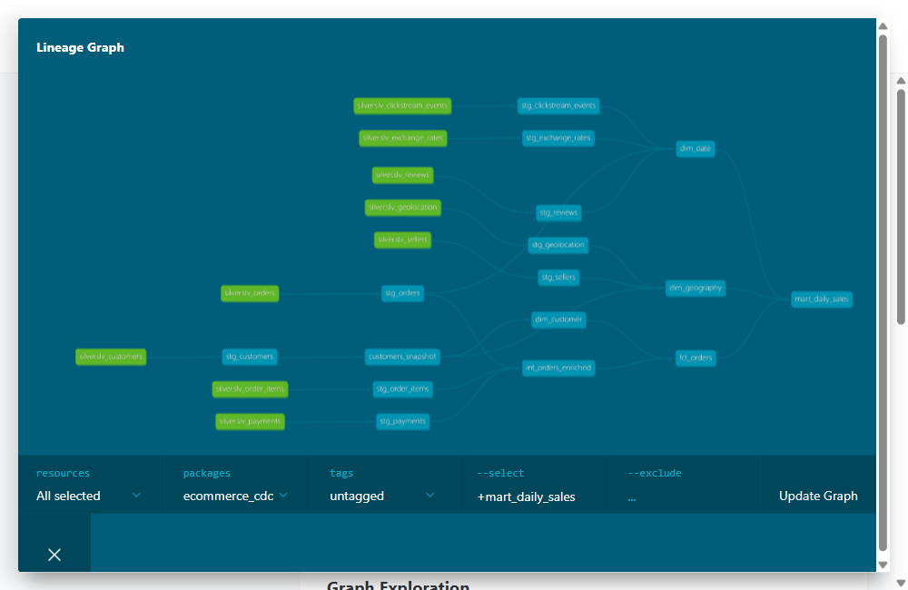

# E-commerce CDC Lakehouse

Portfolio project in progress. The target pipeline is PostgreSQL OLTP → S3 Bronze → Databricks Delta Silver/Gold with dbt-databricks → Power BI, orchestrated by Airflow. Docker Compose configures PostgreSQL 18.6 and Airflow 3.3.2 for local development. Olist loading, the isolated OLTP simulator, Bronze extraction, local Silver, and local Gold/business-mart SQL proof are implemented. The verified local Silver snapshot has been published to Databricks, where Gold and six business marts passed two full dbt builds and source reconciliation. An isolated Stage 1C source-change run passed through the earlier Airflow **local Silver** path and Gold; the owner accepted Stage 6 closure. The new Databricks Spark Silver Job path, repeatability under the same logical date, and unattended scheduling remain unverified. See [PLAN.md](PLAN.md).

## Stage 0: local setup

Prerequisites: Docker Desktop with Compose, and Python 3.13 with [uv](https://docs.astral.sh/uv/) for the Python tools. Allow enough Docker memory for Airflow.

On Windows PowerShell:

```powershell
Copy-Item .env.example .env
# Replace POSTGRES_PASSWORD in .env with a private local password.
docker compose up -d
uv sync --frozen
```

On macOS or Linux, use `cp .env.example .env`, set a private password, then run `make up` (or `docker compose up -d`) and `uv sync --frozen`.

PostgreSQL listens only on `localhost:5432` by default. The database, username and host port come from `.env`. Airflow is at [http://localhost:8080](http://localhost:8080), also bound to localhost. Its initial `admin` password is generated inside the container; read it locally with:

```powershell
docker compose exec airflow cat /opt/airflow/simple_auth_manager_passwords.json.generated
```

Local checks:

```powershell
docker compose ps
docker compose exec postgres sh -c 'pg_isready -U "$POSTGRES_USER" -d "$POSTGRES_DB"'
docker compose exec postgres sh -c 'psql -U "$POSTGRES_USER" -d "$POSTGRES_DB" -Atqc "SHOW wal_level"'
uv run python -c "import faker, pyspark; print('Python tooling OK')"
uv run dbt --version
```

`SHOW wal_level` should return `logical`. On macOS or Linux, `make test` runs the PostgreSQL checks. Stop the local services with `docker compose down`; named volumes retain the local data.

The PostgreSQL 18 image uses a new named volume, `postgres18_data`. The earlier PostgreSQL 15 volume is retained for recovery; it is not mounted into PostgreSQL 18.

The Compose stack is for local development. Keep `.env`, cloud credentials, and generated Airflow passwords out of Git.

## Project code layout

`scripts/` is reserved for repository bootstrap and validation maintained by the Harness. Project data-source code belongs in `sources/`: `sources/oltp/` holds SQLAlchemy models, Alembic migrations, Olist loading, and the isolated OLTP simulator; `sources/clickstream/` holds the event generator. `ingestion/` contains the PostgreSQL Bronze extractor and will hold the remaining source ingesters. `spark_jobs/`, `dbt_project/` and `airflow/dags/` own later transformation and orchestration stages.

## Stage 1: first OLTP table

The OLTP table definitions are in [`models.py`](sources/oltp/models.py). The initial Alembic revision has been generated and applied locally. From the repository root, with `.env` configured and PostgreSQL running, verify the schema with:

```powershell
uv sync --frozen
uv run alembic -c sources/oltp/alembic.ini current
uv run alembic -c sources/oltp/alembic.ini check
```

For later changes, edit a mapped class in `models.py`, then generate a candidate migration with `uv run alembic -c sources/oltp/alembic.ini revision --autogenerate -m "describe change"`. Inspect and correct every generated migration before `upgrade head`; Alembic cannot infer every rename, data migration or business rule. Keep each reviewed revision in Git. `uv run alembic -c sources/oltp/alembic.ini check` reports whether the models and applied schema differ.

The `customers` model treats `customer_id` as the primary key. `customer_unique_id` identifies a person across orders and is indexed, but is not unique in this table. The ZIP prefix is text so leading zeros survive. Stage 1C models customer deletion as `is_deleted/deleted_at` on the isolated simulator database so polling can observe it; the main snapshot remains unchanged.

The nine Olist CSVs in `olist_dataset/` can be loaded into an **empty** migrated database with:

```powershell
uv run python -m sources.oltp.load_olist --dataset olist_dataset
```

On an EC2 client in the RDS VPC, clone the repository and copy `.env.example` to `.env`. Set `POSTGRES_HOST` to the private RDS endpoint, `POSTGRES_PORT` to the RDS port, and `POSTGRES_USER`, `POSTGRES_PASSWORD`, and `POSTGRES_DB` to the RDS database credentials/name. Set `POSTGRES_SSLMODE=verify-full` and `POSTGRES_SSLROOTCERT` to the absolute path of the RDS CA bundle on EC2. Keep `.env` out of Git. Verify the target database is empty before running Alembic or the loader; the main source must remain an untouched initial snapshot until downstream reconciliation.

For the main RDS initial snapshot, apply only the initial revision before loading. The Stage 1C revision stays on the isolated test database until downstream reconciliation:

```bash
uv sync --frozen
uv run alembic -c sources/oltp/alembic.ini upgrade b5e79439fda1
uv run python -m sources.oltp.load_olist --dataset olist_dataset
```

The loader uses PostgreSQL `COPY` in one transaction, checks source headers and foreign keys, and saves row counts plus any rejected rows under `logs/olist_load/`. A nonempty source table causes it to stop; it does not replace existing data. Olist timestamps have no timezone, so the loader interprets them in `America/Sao_Paulo` and writes UTC instants to PostgreSQL. For orders, `created_at` is purchase time and `updated_at` is the latest recorded order event; for reviews, they are creation and answer times. Other tables use one UTC snapshot timestamp for both fields. The estimated delivery date is a forecast and is not used as an update time.

The Stage 1B [baseline summary](docs/baselines/olist_20261023T032906Z_99dc95d7.md) and [full results](docs/baselines/olist_20261023T032906Z_99dc95d7.json) record CSV SHA-256 hashes, the load report, SQL definitions and results under `snapshot_id = olist_20261023T032906Z_99dc95d7`. Its required checks are table counts, raw order-status counts, all-status item-price totals by local purchase month, and six foreign-key orphan counts. Exploratory category, cancellation, review, product, seller and seasonality queries are kept separately in the same file. Every query ran in one read-only repeatable-read transaction. To capture a different load, pass its exact report path:

```powershell
uv run python -m sources.oltp.capture_baseline --load-report logs/olist_load/<run-id>/report.json --dataset olist_dataset
```

Baseline files are immutable by default: the command refuses to overwrite an existing `snapshot_id`. Keep the main source snapshot unchanged until its Bronze/Silver/Gold outputs have been reconciled against the same definitions.

### Stage 1C: isolated source changes

Stage 1C adds `products.current_price` (initialized from the most recent historical sale) and `customers.is_deleted/deleted_at`. The old `order_items.price` values remain unchanged. Apply the new Alembic revision **only to an isolated copy** of the snapshot for now; the main `ecommerce` database and its 1B baseline remain frozen. The simulator refuses database names other than `*_1c_test`.

For a copy named `ecommerce_1c_test`, set `POSTGRES_DB=ecommerce_1c_test` in the current shell, then run:

```powershell
uv run alembic -c sources/oltp/alembic.ini upgrade head
uv run python -m sources.oltp.simulate_new_day --orders 100 --seed 42
uv run python -m sources.clickstream.generate logs/simulator/<run-id>.json
```

The simulator writes a JSON run report under `logs/simulator/`; the clickstream command writes the corresponding JSONL file. It creates new customers and orders, updates product prices and existing customer addresses, and marks some customers as deleted without removing their historical orders. Each report records the affected counts. Main-source execution remains disabled until initial Bronze/Silver/Gold reconciliation, when its safety gate can be reviewed.

### Stage 2: CDC control table

The main RDS source needs the `cdc_watermark` table from revision `d79b3fd3ea12`. If the database is already there, check it with:

```bash
uv run alembic -c sources/oltp/alembic.ini current
```

The current extractor also requires `last_boundary_hash` from `6c4d9b7e2a11`. If the main source is still at `d79b3fd3ea12`, apply **only** this revision before running the updated extractor:

```bash
uv run --frozen alembic -c sources/oltp/alembic.ini upgrade 6c4d9b7e2a11
```

This adds CDC metadata but does not apply Stage 1C source changes. Do not use `upgrade head` on the frozen main source. An isolated 1C database can use its merge revision.

### Stage 2: PostgreSQL to S3 Bronze

On EC2, set `S3_BUCKET` in `.env` to the project bucket name. The instance role needs `s3:PutObject` on `bronze/postgres_oltp/*`. The bucket is in `ap-southeast-1`. With `.env` pointing to the RDS source at `6c4d9b7e2a11` (without Stage 1C), run from the repository root:

```bash
uv sync --frozen
uv run --frozen python -m ingestion.cdc_extract
```

Use `--table orders` to check one table first. Each poll with source rows in its window writes `bronze/postgres_oltp/<table>/load_date=YYYY-MM-DD/run_id=YYYYMMDDTHHMMSSffffff/part-0000.parquet` (rolling to `part-0001.parquet`, etc. every 500,000 rows), then `_manifest.json` as the final object. `load_date` is the UTC ingestion date; `run_id` is a UTC start timestamp with microseconds so nearby runs have separate paths. The manifest retains the exact source-time window. Silver reads only runs whose manifest has `status: committed`, and only the files listed in that manifest. The manifest records the run ID, source, load type, timestamp window, physical row count, per-file size and SHA-256, and start/finish times. The first run has `load_type: snapshot` and a null lower boundary; later runs are `delta`. Each Parquet row includes `ingested_at` and `source_table`.

For each later poll, the exclusive lower bound is `last_updated_at - 15 minutes` and the inclusive upper bound is the source's current maximum `updated_at`. The first poll takes a full snapshot. The extractor fingerprints all rows in the 15-minute overlap ending at the current maximum; if both the maximum and fingerprint are unchanged, it skips S3 upload and only records `last_run_at`. A new row at the same timestamp or anywhere inside the overlap changes that fingerprint, so the window is written again. Silver deduplicates overlapping rows by source key and row version/hash. The source watermark advances only after a committed manifest uploads. A failed attempt can leave an unreferenced Parquet object without a manifest; Silver ignores that run. If the manifest succeeds but the database commit fails, a retry can leave two committed runs with overlapping rows. Polling still misses physical deletes and writes backdated more than 15 minutes below the saved watermark. Orphan cleanup needs a separate retention policy and job; this extractor does not delete S3 objects.

#### Next EC2/RDS check

1. Bring the EC2 checkout to the same revision as the local checkout before running the extractor; a Git bundle procedure is below for commits that are not on the remote. Keep the existing EC2 `.env` private and intact.
2. Confirm `.env` points to the intended RDS database and project S3 bucket, with `AWS_REGION=ap-southeast-1` and no `AWS_PROFILE` or AWS key values on EC2. Check `uv run --frozen alembic -c sources/oltp/alembic.ini current`; if the main RDS source is still at `d79b3fd3ea12`, upgrade only to `6c4d9b7e2a11` as above. It must not include the Stage 1C migration.
3. Run `uv run --frozen python -m ingestion.cdc_extract --table orders` once. In S3, inspect `bronze/postgres_oltp/orders/load_date=<UTC date>/run_id=<run ID>/`: it should contain `part-0000.parquet` and `_manifest.json`. Confirm the manifest has `status: committed`, names that Parquet file, and records its row count and byte size. Download the Parquet file and compare its SHA-256 with the manifest. On the frozen first snapshot, `row_count` should equal `SELECT count(*) FROM orders`; `window.upper_boundary_inclusive` should equal `SELECT max(updated_at) FROM orders`. Check `SELECT table_name, last_updated_at, last_run_at FROM cdc_watermark WHERE table_name = 'orders'` after the upload.
4. Once the single-table result is correct, run `uv run --frozen python -m ingestion.cdc_extract` for all nine OLTP tables. Check the other eight tables' first-snapshot manifest counts against their source counts. An unchanged second poll creates no manifest; adding a row inside the overlap creates a delta manifest for that window. Keep the main OLTP snapshot frozen until Bronze/Silver/Gold reconciliation; use the isolated `*_1c_test` database for simulator changes.

The user reports an EC2/RDS `orders` upload, but its RDS watermark and S3 manifest have not been independently reconciled. PostgreSQL extraction has passed focused tests against disposable PostgreSQL and fake S3. A local nine-table snapshot was reconciled against the test bucket. The overlap fingerprint now prevents repeated upload when a source table is unchanged; it has not yet been run against RDS with the new migration.

### Stage 2: clickstream and API Bronze

For the main project bucket, generate demo clickstream from the committed RDS `orders` and `order_items` snapshots already in S3 Bronze. The generator verifies each Parquet file against its manifest, samples delivered orders across the purchase-date range, and uses their real customer, product, order, and purchase-time values. It does not modify RDS. Create a new output file, then upload it to the project bucket:

```powershell
$projectBucket = "<project-bucket>"  # replace with the bucket behind the ecommerce_cdc_s3 external location
uv run --frozen python -m sources.clickstream.generate_from_bronze --bucket $projectBucket --output logs/clickstream/rds_snapshot_demo.jsonl --count 20
$env:S3_BUCKET = $projectBucket
uv run --frozen python -m ingestion.ingest_logs logs/clickstream/rds_snapshot_demo.jsonl
```

The ingester validates each JSON object, compresses the file, then uploads `events.json.gz` under `bronze/clickstream/dt=<UTC ingestion date>/hour=<UTC hour>/run_id=<UTC start timestamp>/`. It uploads `_manifest.json` last with `status=committed`, the event count, file size, and SHA-256. A repeat invocation creates another run; Silver must deduplicate by `event_id`. The generator gives the same source order and event type a stable `event_id`. Clickstream from an isolated Stage 1C simulator remains separate because those order IDs may not exist in the main RDS snapshot.

The API ingester accepts an exchange-rate or campaign JSON endpoint. [Frankfurter](https://frankfurter.dev/) provides free historical BRL/USD rates without an API key; the URL below starts before the first Olist order so a preceding reference day is available. To serve the synthetic campaign fixture, run the HTTP server in a separate terminal:

```powershell
uv run --frozen python -m http.server 8765 --bind 127.0.0.1 --directory sources/api
```

Then ingest both responses:

```powershell
uv run --frozen python -m ingestion.ingest_api --source exchange_rate --url "https://api.frankfurter.dev/v2/rates?from=2016-09-01&to=2018-10-17&base=BRL&quotes=USD"
uv run --frozen python -m ingestion.ingest_api --source campaign --url "http://127.0.0.1:8765/mock_campaigns.json"
```

The ingester tries transient failures three more times, stores the exact JSON response at `bronze/api/<source>/dt=<UTC ingestion date>/run_id=<UTC start timestamp>/response.json`, then writes a committed manifest with byte size and SHA-256. The campaign response is synthetic and maps the clickstream generator's `direct`, `search`, and `social` sources; do not treat its discounts as Olist facts. Historical exchange rates are daily reference data, so Silver/Gold must define how to join non-business days. Do not put API secrets in URLs; authenticated endpoints need an explicitly configured header before use. Both ingesters use the same S3 bucket and credential settings as the PostgreSQL extractor.

For EC2 uploads, extend its instance role's `s3:PutObject` permission to `bronze/clickstream/*` and `bronze/api/*` as well as the existing PostgreSQL Bronze prefix. Generating clickstream from committed snapshots also needs `s3:ListBucket` and `s3:GetObject` for the `orders` and `order_items` Bronze prefixes. On 2026-10-31, the project bucket was verified with one 80-event clickstream run joining 20 RDS snapshot orders, one 777-rate Frankfurter response, and one 3-entry synthetic campaign response; each committed manifest's byte size and SHA-256 matched its S3 data object.

To transfer the local commits to the existing EC2 clone without pushing to GitHub, create a bundle from the local repository and upload it with Terminus SFTP. The bundle does not include the ignored `.env`:

```powershell
git bundle create ../ecommerce-stage2.bundle origin/main..HEAD
```

On EC2, after uploading the bundle to `~/ecommerce-stage2.bundle`, run from the repository root:

```bash
git status --short
git bundle verify ~/ecommerce-stage2.bundle
git fetch ~/ecommerce-stage2.bundle HEAD
git merge --ff-only FETCH_HEAD
```

Proceed only if the EC2 checkout has no unexpected tracked changes and the bundle verifies. A failed fast-forward means the checkouts have diverged and need reconciliation before extraction. Do not replace the EC2 `.env`.

For local development, put `AWS_ACCESS_KEY_ID` and `AWS_SECRET_ACCESS_KEY` in the ignored `.env` to let this extractor upload without `aws login`. Add `AWS_SESSION_TOKEN` only for temporary credentials; those expire. A complete key pair takes priority over `AWS_PROFILE`. Alternatively, set `AWS_PROFILE` in `.env` to a temporary-credential profile that boto3 can use; AWS CLI v2 can obtain one with [`aws login`](https://docs.aws.amazon.com/cli/latest/userguide/cli-configure-sign-in.html). The AWS CLI does not read this project's `.env`; these keys are for the Python extractor. Do not commit or share `.env`. On EC2, leave all three key variables and `AWS_PROFILE` unset so boto3 uses the instance role. A private RDS endpoint still requires network access from the local machine; S3 credentials alone do not provide it.

### Stage 3: local Silver

The local Spark job reads only committed Bronze manifests and the files each manifest lists. It verifies file size, SHA-256 and recorded row counts before transforming; uncommitted runs and unlisted files are ignored. It writes 12 Delta tables plus `silver_quarantine` under a local output directory. Duplicate source keys collapse to the newest `updated_at`; a later ingestion resolves equal source timestamps. Delta MERGE leaves older source versions and repeated runs from replacing current rows. Invalid keys/timestamps, missing customer IDs, clickstream events without a Silver customer, purchase events without a matching order/customer or order-item/product, negative `order_items.price`, and malformed API values go to quarantine with a reason and source run ID. The Olist model has no `email`, `quantity`, or `unit_price` columns; the corresponding generic checks in the plan apply only if those fields appear in a source schema.

Windows Spark cannot run this Delta configuration with the machine's Java 24 and missing Hadoop `winutils.exe`, so the reproducible local proof uses Docker Linux with Java 17. From PowerShell in the repository root:

```powershell
docker build -f docker/silver.Dockerfile -t ecommerce-silver-local .
docker run --rm --mount "type=bind,source=$((Get-Location).Path),target=/workspace" --env SILVER_TEST_DOCKER=1 ecommerce-silver-local uv run --frozen python -m unittest tests.test_silver_local -v
```

To repeat the PostgreSQL → Bronze → Silver price-update proof, start the local Compose PostgreSQL and run this test with Docker available. It creates and drops a uniquely named local test database; Docker Desktop may leave ignored Delta test files under `logs/silver_e2e_*/` because Windows can deny immediate bind-mount cleanup.

```powershell
docker compose up -d postgres
$env:SILVER_PG_E2E = "1"
uv run --frozen python -m unittest tests.test_silver_postgres_e2e -v
```

To make a full local Bronze input from the existing Docker PostgreSQL snapshot, start its container, then run the local materializer. It reads PostgreSQL in one read-only transaction, writes all nine Parquet snapshots and committed manifests to `logs/local_bronze/`, compresses the existing local clickstream JSONL, and fetches the two API responses into the same local tree. It does not write to PostgreSQL, S3, or EC2:

```powershell
docker compose up -d postgres
uv run --frozen python -m ingestion.local_bronze --root logs/local_bronze --clickstream logs/clickstream/rds_snapshot_20261031.jsonl
```

The clickstream path above is a generated local file from this checkout; use another local JSONL path if yours differs. Run one dataset or omit `--dataset` for all 12:

```powershell
docker run --rm --mount "type=bind,source=$((Get-Location).Path),target=/workspace" ecommerce-silver-local uv run --frozen python -m spark_jobs.silver_transform --bronze-root /workspace/logs/local_bronze --silver-root /workspace/logs/local_silver
docker run --rm --mount "type=bind,source=$((Get-Location).Path),target=/workspace" ecommerce-silver-local uv run --frozen python -m spark_jobs.verify_silver --silver-root /workspace/logs/local_silver
```

The verifier checks all 12 tables for missing or duplicate keys, and checks that purchase events join to their order/customer and order-item product. The exchange-rate business date stays in `date`; its Silver `updated_at` is the API ingestion time used to choose the latest fetched value for a date/currency pair. Campaigns retain `synthetic=true`. The local Silver snapshot was subsequently uploaded to the project S3 bucket under `silver/stage3_local_20261102/` and registered as 12 external Delta tables in `ecommerce_cdc.silver`; Databricks counts match all local tables. (In Stage 6, `silver_transform.py` was enhanced to run directly on Databricks Spark clusters against S3 Bronze).

### Stage 4: Gold star schema

`dbt_project/` contains 12 pass-through Silver staging views, customer/product SCD2 snapshots, two intermediate models, seven conformed dimensions, seven facts split into commerce/behavior/reference, and the optional synthetic campaign dimension. Each fact keeps its source grain: orders, order items, payments, reviews, click events, sessions, or daily FX rates. Order and item revenue come from historical `order_items.price`; payment totals are separate. Purchase and event date keys use the `America/Sao_Paulo` business date so they can be reconciled with the Olist baseline. Customer RFM must group by `customer_unique_id`.

Run the SQL locally against the existing `logs/local_silver/` Delta directory using Docker Linux/Java 17:

```powershell
docker run --rm --mount "type=bind,source=$((Get-Location).Path),target=/workspace" ecommerce-silver-local uv run --frozen python -m spark_jobs.verify_gold --silver-root /workspace/logs/local_silver --project-dir /workspace/dbt_project --baseline /workspace/docs/baselines/olist_20261023T032906Z_99dc95d7.json
docker run --rm --mount "type=bind,source=$((Get-Location).Path),target=/workspace" ecommerce-silver-local uv run --frozen python -m unittest tests.test_gold_scd2_local -v
```

The local proof executed all 29 dbt model SELECTs against the 12 Silver tables, checked the six source-level fact counts, and found 20 sessions. The historical item price total was BRL 13,591,643.70; the 24 purchase months also matched the frozen Stage 1B baseline. Five singular dbt tests passed locally, and a duplicate item deliberately failed the grain check. The SCD2 fixture used two customer/product versions to check the old-order fallback and the unchanged sale price. This proof does **not** execute dbt snapshots, generic tests, or Delta incremental MERGE.

To reproduce the cloud build, copy `dbt_project/profiles.yml.example` to the ignored `dbt_project/profiles.yml` and set `DBT_DATABRICKS_HOST`, `DBT_DATABRICKS_HTTP_PATH`, `DBT_CATALOG=ecommerce_cdc`, `DBT_SILVER_SCHEMA=silver`, and `DBT_TARGET_SCHEMA=analytics_dev` in the local shell. The profile uses interactive OAuth and stores no token in Git. Then run:

```powershell
uv run --frozen dbt build --project-dir dbt_project --profiles-dir dbt_project
uv run --frozen dbt build --project-dir dbt_project --profiles-dir dbt_project
uv run --frozen dbt docs generate --project-dir dbt_project --profiles-dir dbt_project
```

On 2026-11-02, both full cloud builds passed 122/122 nodes with 85 data tests and zero errors. The first created Gold and the snapshots; Delta history confirms that the second performed `MERGE` on `fct_orders`. Counts remained 99,441 orders and 112,650 items, total item price stayed BRL 13,591,643.70, and all 24 purchase months matched the independent PostgreSQL baseline. `dbt docs generate` succeeded; this is the inspected lineage for `mart_daily_sales`:



An isolated Databricks Silver copy proved snapshot behavior: changing one customer's city and one product's `current_price` created a second version of each with the old `dbt_valid_to` closed. The historical order retained its original customer/product keys and BRL 44.99 item price while the new catalog price was BRL 54.99. The main Silver/OLTP snapshots were not changed. A separate isolated Stage 1C source → Bronze → Silver → dbt run later passed in Stage 6; the frozen main Silver snapshot has no `products.current_price` or soft-delete fields. The earlier second `fct_orders` MERGE updated all 99,441 unchanged rows. Stage 6 added a same-key/same-ingestion-time exclusion to the six incremental facts; a later full cloud build passed 122/122, and Delta history showed zero updated and zero inserted rows for all six facts on unchanged Silver.

### Stage 5: business marts

`dbt_project/models/marts/business/` contains six tables: `mart_daily_sales` (purchase date × customer state), `mart_product_performance` (product × seller × sale-time category), `mart_customer_rfm` (unique shopper), `mart_funnel_daily` (session start date × device × channel), `mart_payment_mix_daily` (related order purchase date × payment type), and `mart_order_experience_daily` (delivered-order purchase cohort × customer state). Sales and RFM use delivered item price; payment value remains a separate payment measure. Reviews are averaged per order before the experience join. The funnel is from synthetic order-derived sessions, and no refund, product-level rating, or campaign attribution KPI is inferred.

RFM uses an `as_of_date` one day after the latest delivered purchase in the available data. Tie-aware percentile ranks give equal recency, frequency, or monetary values equal 1–5 scores. The five segment rules and their priority are recorded in [PLAN.md](PLAN.md). As new delivered orders arrive, the current RFM mart is recomputed; it is not a historical segment snapshot.

Run the full Stage 4–5 SQL proof locally:

```powershell
docker run --rm --mount "type=bind,source=$((Get-Location).Path),target=/workspace" ecommerce-silver-local uv run --frozen python -m spark_jobs.verify_gold --silver-root /workspace/logs/local_silver --project-dir /workspace/dbt_project --baseline /workspace/docs/baselines/olist_20261023T032906Z_99dc95d7.json --business
```

The local run checked all eight dimension keys, six mart grains, fact totals, RFM scores/ties, and funnel bounds; it rejected a duplicate sales-row fixture. On Databricks, all six marts and their generic/singular tests passed in both full builds, and their row counts match local proof. Delivered item revenue in `mart_daily_sales` is BRL 13,221,498.11, matching the independent PostgreSQL baseline in all 12 calendar months. For 2018-01-01 in `America/Sao_Paulo`, local PostgreSQL and Databricks both returned 81 items, BRL 6,948.21 item price, and BRL 6,818.31 delivered item revenue.

### Stage 6: local Airflow to Databricks

The `ecommerce_cdc_daily` DAG is paused by default. It uploads PostgreSQL CDC, the BRL/USD API, the synthetic campaign fixture, and deterministic demo clickstream into S3 Bronze. It then waits for a Databricks Spark Python Job through `DatabricksRunNowOperator`. That Job reads only committed Bronze manifests and their referenced files from S3, merges Delta Silver on S3, checks unique/non-null keys and purchase joins, runs three Great Expectations rules, and registers the 12 Silver tables and quarantine table in Unity Catalog. Only Job success permits `dbt build` for Gold and marts. Airflow records status and layer/mart counts in `ecommerce_cdc.ops.ops_pipeline_runs`; a configured webhook receives task-failure alerts. The earlier local sync/upload scripts and OpenJDK have been removed from the Airflow path.

Create one Databricks Job with a **Spark Python task**, pointing at `spark_jobs/silver_transform.py` from the same Git revision as this checkout (or a workspace copy containing `spark_jobs/silver_schema.py` alongside it). For serverless environment version 6, add `great-expectations==1.24.1` to the Job environment dependencies; do not request the `[spark]` extra, because the environment already supplies Spark Connect and the extra's PySpark constraint conflicts with it. PySpark and Delta must be provided by the selected Databricks environment. The manifest reader uses `ignoredPathSegmentRegex` to include `_manifest.json`, which requires Databricks Runtime 19 or newer; verify support when using serverless compute. Grant the Job identity read access to the Bronze S3 external location and read/write access to the Silver external location and target Unity Catalog schema. The transform uses Spark file reads for manifests and checksums, so the Job does not need a separate `boto3` credential. Set `DATABRICKS_SILVER_JOB_ID` to that Job's numeric ID. Airflow passes `--bronze-root s3://<AIRFLOW_S3_BUCKET>/<PIPELINE_S3_PREFIX>`, `--silver-root .../silver/pipeline_live`, `--catalog`, and `--schema` as `python_params`. The prefix segment is omitted for the main pipeline. Use an isolated prefix and schema for the first standalone Job run, then inspect Delta counts, GX results, and table locations before triggering the Airflow DAG. An isolated remote Job passed all 12 tables, its quality gate, and Unity Catalog registration on 2026-11-05; the main Bronze input and full Airflow DAG run remain unverified.

The transform rejects corrupt manifest payloads before parsing their Parquet/JSON records and rejects new negative payments or future events before merging those datasets. A failure later in a multi-table Job can leave already-merged Silver tables advanced; Gold remains gated. Correct the source or manifest and rerun the Job, then inspect Delta history if a rollback is needed.

On 2026-11-05, isolated Databricks Jobs passed all 12 Silver tables, the purchase-join and Great Expectations quality gate, and all 13 Unity Catalog registrations. A run against the then-configured test bucket kept 80 clickstream events and quarantined 80 old events whose customers were absent from the current snapshot. The subsequent Airflow DagRun stopped during Silver when Databricks Free Edition reported its daily compute limit; Gold, marts, and Ops completion were not validated in that run. Airflow is paused until compute is available again. For the next main run, `AIRFLOW_S3_BUCKET` must point to the project bucket used by the main `ecommerce_cdc.silver` schema.

Configure the ignored `.env` using `.env.example`: `AIRFLOW_S3_BUCKET` must be the **project bucket covered by the Databricks external location**, even if `S3_BUCKET` for other local commands points to a test bucket. Also set AWS credentials (or a local AWS profile), PostgreSQL settings, `DBT_DATABRICKS_HOST`, `DBT_DATABRICKS_HTTP_PATH`, `DBT_CATALOG`, `DBT_SILVER_SCHEMA`, `DBT_TARGET_SCHEMA`, `DATABRICKS_TOKEN`, `DATABRICKS_SILVER_JOB_ID`, and `AIRFLOW_ALERT_WEBHOOK_URL`. Compose builds Airflow's Databricks connection from `DBT_DATABRICKS_HOST` and `DATABRICKS_TOKEN`; remove any old `AIRFLOW_CONN_DATABRICKS_DEFAULT` entry from `.env`. The Airflow web UI is accessible at `http://localhost:8080`; read the generated `admin` password with the command above. Do not put the token or webhook URL in Git.

The RDS database is private. To use it from local Airflow, provide network access through an existing SSH tunnel or VPN. For an SSH local port forward, set `AIRFLOW_POSTGRES_PORT` to the forwarded local port and `AIRFLOW_POSTGRES_HOST=host.docker.internal`; the Airflow container then connects through the host. For local Compose PostgreSQL, use its published port and the same host setting. Set `AIRFLOW_POSTGRES_DB` to choose the Airflow source without changing the database used by other local commands. The source database must have the `6c4d9b7e2a11` CDC metadata revision. Do not point this DAG at the main frozen source for a Stage 1C simulator run.

For the isolated Stage 1C rehearsal, point PostgreSQL at the `*_1c_test` database and set `PIPELINE_S3_PREFIX=stage6_1c_test`, `DBT_SILVER_SCHEMA=silver_validation_1c`, and `DBT_TARGET_SCHEMA=validation_1c` together in the ignored `.env`. Use the existing project bucket and catalog; the namespace adds separate `stage6_1c_test/bronze/` and `stage6_1c_test/silver/` S3 paths and separate Databricks Silver/Gold/snapshot schemas. The DAG refuses an isolated prefix paired with the main Silver or Gold schema. Run the simulator only against that isolated database before triggering the DAG, and restart Airflow after changing `.env`. The synthetic clickstream task waits for the CDC snapshot and uses only the isolated prefix.

After the connection and credentials are ready, check the runtime without starting a pipeline:

```powershell
docker compose up -d --build airflow
docker compose exec airflow airflow dags list
docker compose exec airflow airflow dags list-import-errors
docker compose exec airflow bash -lc "uv run --frozen dbt debug --project-dir /workspace/dbt_project --profiles-dir /workspace/airflow/dbt_profile"
```

Then trigger one manual run in the Airflow UI at `http://127.0.0.1:8080` (login: `admin` / the generated password from the command above); inspect the task graph and `ops_pipeline_runs` before unpausing the daily schedule. `record_pipeline_failure` writes failure status when any upstream task fails and leaves the DAG failed. An unchanged CDC poll creates no new manifest; a repeated clickstream/campaign demo run still writes new Bronze run IDs but Silver deduplicates stable event/campaign keys.

The following 2026-11-02 evidence used the **previous local Silver/sync/publication DAG**, not the new Databricks Spark Job path. `airflow dags test ecommerce_cdc_daily 2026-11-02` ran end to end against the isolated `ecommerce_1c_test` database, `stage6_1c_test/` S3 prefix, and `silver_validation_1c`/`validation_1c` Databricks schemas. Bronze → Silver → Gold produced 99,461 orders in both Silver and Gold; all 122 dbt resources passed, quarantine was zero, and Ops recorded success with 1,551,109 Bronze/Silver rows and 150,672 business-mart rows. The main Silver table location remained unchanged. A repeated `orders` poll scanned and published zero rows. The test used a short-lived interactive OAuth token supplied only to the temporary container. For unattended daily runs, provide a separate noninteractive Databricks token and real alert webhook, arrange private-RDS access, and apply the targeted CDC metadata migration to that source.

An isolated negative-payment test made `slv_payments` fail all three GX attempts; Airflow did not publish Silver or run dbt, the local webhook received an alert, and the existing Gold order count stayed at 99,461. The payment was restored to 99.33 in the isolated source. A concurrent `airflow dags test` with the same logical date caused a SQLite metadata conflict, and Docker Desktop stopped during the subsequent recovery run after the GX gate passed. Both interrupted Ops rows were marked `failed` with their causes. Run further `dags test` commands **sequentially** and recheck the final DagRun state on a stable Docker runtime. The scheduled, unattended path remains unverified.

The recovered local Silver has 103,906 payments, zero duplicate payment keys, zero negative values, and the restored payment at 99.33. Publishing that Silver from local code succeeded; a separate full dbt build passed 122/122. Databricks Gold now has 99,461 orders and 103,906 payments, with no negative payments. The recovery was completed through individual publish/dbt commands after the Docker interruption; it is not evidence of a second completed Airflow DagRun.

The owner subsequently reported a successful full DAG run and accepted Stage 6 closure. The local Airflow metadata inspected on 2026-11-02 still showed one manual run `running` at `verify_silver` and one `queued`, with no matching success run ID supplied. Treat that report as owner acceptance, not independent verification of the later run. The Stage 7 plan carries the Ops/run-ID reconciliation and keeps repeatability and unattended scheduling as open checks.

## Stage 0 cloud status

AWS Console and CloudShell access in `ap-southeast-1` have been checked. The project S3 bucket has Block Public Access, ACLs disabled, and default SSE-S3 encryption. A small object was uploaded, inspected, and deleted using the AWS CLI in CloudShell. The bucket name and cloud credentials are intentionally kept out of this repository.

Databricks Free Edition CLI login is configured outside the repository. The workspace metastore is in `us-east-2`; the project S3 bucket stays in `ap-southeast-1` by choice. A project-scoped IAM role, Unity Catalog storage credential and external location were created. Databricks validation passed `READ`, `LIST`, `WRITE` and `DELETE` against that bucket. On 2026-11-02 the project catalog `ecommerce_cdc` was created with managed Gold storage under the bucket's `gold/` prefix, and the proven local Silver snapshot was registered from its `silver/` prefix. This cross-Region path can add transfer cost and latency; measure both before scaling.
