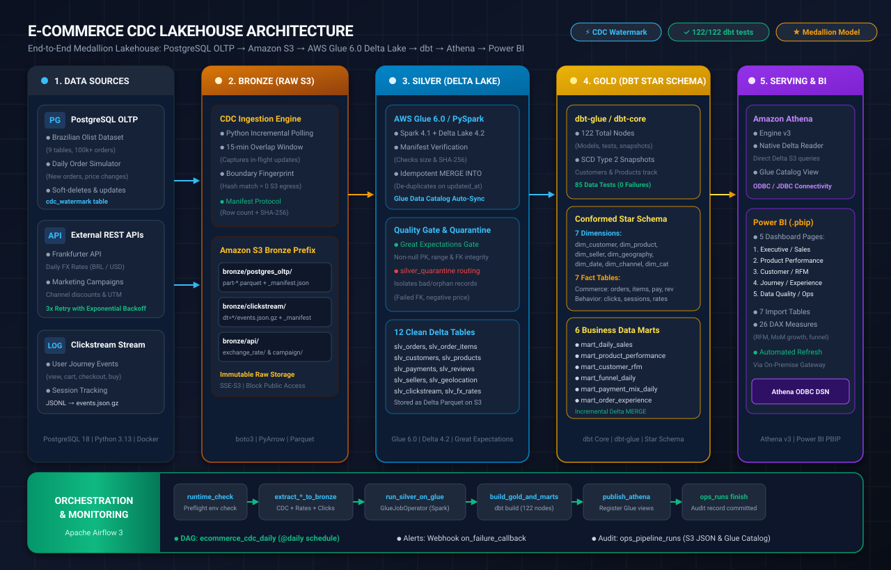
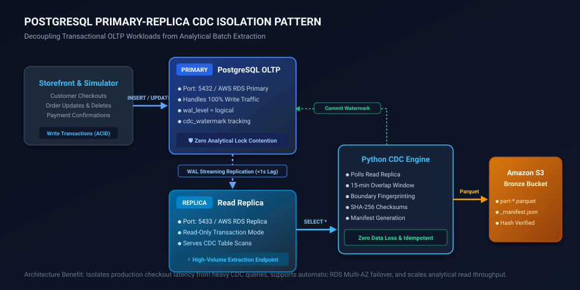
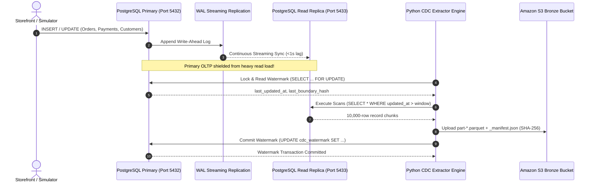

# E-Commerce CDC Lakehouse Platform

[](https://www.python.org/)
[](https://www.postgresql.org/)
[](https://spark.apache.org/)
[](https://delta.io/)
[](https://aws.amazon.com/glue/)
[](https://aws.amazon.com/s3/)
[](https://www.getdbt.com/)
[](https://airflow.apache.org/)
[](https://aws.amazon.com/athena/)
[](https://powerbi.microsoft.com/)
[](https://greatexpectations.io/)

> **Production-grade End-to-End Medallion Lakehouse (Bronze → Silver → Gold)** featuring **PostgreSQL Primary-Replica OLTP isolation**, near-real-time **Change Data Capture (CDC)**, idempotent **Delta Lake merges on Apache Spark / AWS Glue 6.0**, **dbt Core dimensional modeling** (Star Schema with SCD Type 2 tracking & 6 Business Data Marts), automated **Apache Airflow orchestration**, and an executive **Power BI analytics dashboard** connected via Amazon Athena.

---

## 📌 Table of Contents

- [1. Project Overview & Architecture Goals](#1-project-overview--architecture-goals)
  - [Business Context & Problem Statement](#business-context--problem-statement)
  - [Real-World Datasets & Daily Transaction Simulator](#real-world-datasets--daily-transaction-simulator)
  - [Key Architectural Highlights](#key-architectural-highlights)
- [2. End-to-End Pipeline Architecture](#2-end-to-end-pipeline-architecture)
  - [Architecture Diagram](#architecture-diagram)
  - [Medallion Lakehouse Data Flow](#medallion-lakehouse-data-flow)
- [3. PostgreSQL Primary-Replica CDC Isolation Pattern](#3-postgresql-primary-replica-cdc-isolation-pattern)
  - [Design Rationale: Zero OLTP Contention](#design-rationale-zero-oltp-contention)
  - [Primary-Replica Interaction Flow](#primary-replica-interaction-flow)
  - [Configuration & Connection Decoupling](#configuration--connection-decoupling)
- [4. Medallion Lakehouse Deep-Dive](#4-medallion-lakehouse-deep-dive)
  - [Bronze Layer: CDC Polling & Committed Manifest Protocol](#bronze-layer-cdc-polling--committed-manifest-protocol)
  - [Silver Layer: Delta Lake Idempotent Merge & Quarantine Routing](#silver-layer-delta-lake-idempotent-merge--quarantine-routing)
  - [Gold Layer: dbt Star Schema & 6 Business Data Marts](#gold-layer-dbt-star-schema--6-business-data-marts)
  - [Serving Layer: Amazon Athena Engine v3](#serving-layer-amazon-athena-engine-v3)
  - [Orchestration & DataOps: Apache Airflow 3](#orchestration--dataops-apache-airflow-3)
- [5. Technology Stack](#5-technology-stack)
- [6. Data Modeling & Dimensional Design](#6-data-modeling--dimensional-design)
  - [Slowly Changing Dimensions (SCD Type 2)](#slowly-changing-dimensions-scd-type-2)
  - [Conformed Star Schema & Analytical Marts](#conformed-star-schema--analytical-marts)
  - [dbt Lineage Graph](#dbt-lineage-graph)
- [7. Business Intelligence & Power BI Dashboard](#7-business-intelligence--power-bi-dashboard)
- [8. Repository Layout](#8-repository-layout)
- [9. Quickstart & Local Reproduction Guide](#9-quickstart--local-reproduction-guide)
  - [Prerequisites](#prerequisites)
  - [Step 1: Local Stack Initialization & Python Tooling](#step-1-local-stack-initialization--python-tooling)
  - [Step 2: Seed Olist Dataset & Establish Audit Baseline](#step-2-seed-olist-dataset--establish-audit-baseline)
  - [Step 3: Ingest CDC to Amazon S3 Bronze](#step-3-ingest-cdc-to-amazon-s3-bronze)
  - [Step 4: Execute Spark Silver Transformation & Quality Gate](#step-4-execute-spark-silver-transformation--quality-gate)
  - [Step 5: Build Gold Star Schema & Marts with dbt](#step-5-build-gold-star-schema--marts-with-dbt)
  - [Step 6: Orchestrate Pipeline with Apache Airflow](#step-6-orchestrate-pipeline-with-apache-airflow)
  - [Step 7: Connect & Refresh Power BI Dashboard](#step-7-connect--refresh-power-bi-dashboard)
- [10. Data Reconciliation & Audit Verification](#10-data-reconciliation--audit-verification)

---

## 1. Project Overview & Architecture Goals

### Business Context & Problem Statement
In fast-paced e-commerce retail environments, transactional databases (OLTP) continuously experience high-frequency state changes: incoming orders, payment captures, delivery status transitions, customer address updates, catalog price adjustments, and customer reviews. Running intensive analytical queries and bulk extraction jobs directly against production transactional databases creates severe thread locking, CPU spikes, and degrades customer checkout latencies.

This platform implements an enterprise-grade **Modern Data Lakehouse** engineered to solve these challenges:
- **Zero OLTP Impact (Primary-Replica Isolation)**: Decouples write-intensive storefront checkouts from analytical CDC batch extractions via dedicated streaming read replicas.
- **Near-Real-Time Change Data Capture (CDC)**: Incremental polling engine equipped with 15-minute sliding overlap windows to capture in-flight transactions without data loss.
- **Strict Idempotency & Zero Data Loss**: Guarantees that arbitrary re-runs, historical backfills, or network glitches will never duplicate records or inflate GMV numbers.
- **Historical Accuracy (SCD Type 2)**: Tracks point-in-time catalog price changes and customer relocation history so historical sales metrics reflect actual prices at purchase time.
- **Automated Data Quality & Quarantine Architecture**: Evaluates Great Expectations assertions and isolates malformed records into a dedicated quarantine table without halting the pipeline.
- **Executive & Operational BI**: Serves curated dimensional data marts through Amazon Athena to a multi-page Power BI dashboard.

### Real-World Datasets & Daily Transaction Simulator
1. **Brazilian E-Commerce Dataset (Olist)**:
   - Real-world production dataset consisting of ~100,000 orders spanning 2016–2018 across 9 relational tables: `customers`, `sellers`, `products`, `orders`, `order_items`, `payments`, `reviews`, `geolocation`, and `category_translation`.
2. **Daily Order Simulator**:
   - Generates realistic post-snapshot transactional updates: new order placement, product price updates (`products.current_price`), customer address migrations, and soft deletes (`is_deleted`/`deleted_at`) to rigorously test CDC detection.
3. **Clickstream Event Generator**:
   - Produces clickstream events (`view`, `add_to_cart`, `checkout`, `purchase`) linked to real orders and customer identities to fuel conversion funnel analytics.
4. **External Reference APIs**:
   - Real-time foreign exchange rates (BRL/USD daily rates via **Frankfurter API** with exponential backoff retries) and synthetic multi-channel marketing campaigns.

### Key Architectural Highlights
- **100% Data Fidelity Across Layers**: Fully verified against an independent baseline—all 99,441 orders, 112,650 items, and BRL 13,591,643.70 GMV reconcile across PostgreSQL, S3 Bronze, Delta Silver, and dbt Gold.
- **Dual-Engine Flexibility**: Fully runnable locally inside Docker containers (Linux / Java 17 / Spark 4.1) or scalable in the cloud on **AWS Serverless** (AWS Glue 6.0 + S3 + Athena v3) or **Databricks Serverless** (Unity Catalog).
- **122/122 dbt Nodes Passed**: 85 automated data tests and schema validations with 0 errors.

---

## 2. End-to-End Pipeline Architecture

### Architecture Diagram



### Medallion Lakehouse Data Flow

```mermaid
flowchart LR
    subgraph Sources ["1. PRIMARY-REPLICA & SOURCES"]
        P_DB[("PostgreSQL Primary\n(Port 5432 - Writes)")]
        R_DB[("PostgreSQL Read Replica\n(Port 5433 - Read-Only)")]
        API["External APIs\n(FX Rates & Campaigns)"]
        LOG["Clickstream Gen\n(JSONL Events)"]
        P_DB -- "WAL Streaming Replication\n(&lt;1s Lag)" --> R_DB
    end

    subgraph Bronze ["2. BRONZE LAYER (Amazon S3)"]
        EXT["Python CDC Extractor\n(Watermark & Overlap)"]
        S3B["Raw Parquet & JSON.gz\n+ _manifest.json"]
    end

    subgraph Silver ["3. SILVER LAYER (Delta Lake)"]
        GLUE["AWS Glue 6.0 / Spark 4.1\n(Delta Lake 4.2)"]
        GX{"Great Expectations\nQuality Gate"}
        SLV[("12 Clean Delta Tables\nGlue Data Catalog")]
        QUAR[("silver_quarantine\n(Isolated Bad Records)")]
    end

    subgraph Gold ["4. GOLD LAYER (dbt Core)"]
        DBT["dbt-glue / dbt-core\n(122 Nodes & Snapshots)"]
        STAR[("Star Schema\n7 Dims + 7 Facts")]
        MARTS[("6 Business Marts\nDelta Lake on S3")]
    end

    subgraph Serving ["5. SERVING & BI"]
        ATHENA["Amazon Athena v3\n(Serverless SQL)"]
        PBI["Microsoft Power BI\n(5 Report Pages / 26 Measures)"]
    end

    R_DB --> EXT
    API --> EXT
    LOG --> EXT
    EXT --> S3B
    S3B --> GLUE
    GLUE --> GX
    GX -- "Pass" --> SLV
    GX -- "Fail" --> QUAR
    SLV --> DBT
    DBT --> STAR
    STAR --> MARTS
    MARTS --> ATHENA
    ATHENA --> PBI
```



---

## 3. PostgreSQL Primary-Replica CDC Isolation Pattern

### Design Rationale: Zero OLTP Contention
In production enterprise architectures, running high-frequency CDC polling queries, massive table scans, and 15-minute sliding overlap boundary fingerprint checks directly against the primary transactional database introduces severe risk:
1. **Row and Table Locks**: Long-running scans block transactional updates on active shopping carts and pending payments.
2. **Buffer Cache Eviction**: Heavy analytical queries flush frequently accessed OLTP pages from shared buffers, causing latency spikes for customer checkouts.
3. **CPU & I/O Spikes**: Analytical filtering consumes resources intended for user-facing API workloads.

To eliminate these issues, this project implements a **Primary-Replica Isolation Pattern**:
- **Primary Node (`POSTGRES_HOST:5432`)**: Dedicated to OLTP write transactions (customer checkouts, payment state machine, simulator updates). Configured with `wal_level=logical`.
- **Physical Streaming Replication**: Continuously streams Write-Ahead Logs (WAL) to the read replica with sub-second replication latency.
- **Read Replica Node (`POSTGRES_REPLICA_HOST:5433`)**: Dedicated read-only endpoint where the Python CDC Extractor performs all large scans, timestamp range queries, and boundary fingerprint hashes.
- **Transactional Watermark State**: Watermark updates are written back to the Primary `cdc_watermark` table using transactional `FOR UPDATE` semantics to ensure deterministic progression.

### Primary-Replica Interaction Flow





### Configuration & Connection Decoupling
The extraction engine decouples read queries from metadata commits seamlessly:
```python
# ingestion/cdc_extract.py
primary_opts = connection_settings(settings)
replica_opts = replica_connection_settings(settings)

# Table data scans are offloaded to the Read Replica
read_conn = connection if replica_opts == primary_opts else psycopg.connect(**replica_opts)
try:
    with read_conn.cursor() as read_cursor:
        read_cursor.execute("SELECT max(updated_at) FROM ...")
        # Heavy overlap fingerprint & parquet generation run on replica:
        chunks, scanned_rows = write_parquet(read_conn, ...)
finally:
    if read_conn is not connection:
        read_conn.close()

# Watermark progress is committed back to Primary
cursor.execute("UPDATE cdc_watermark SET last_updated_at = %s, ...")
```
If `POSTGRES_REPLICA_HOST` is not configured, the extractor automatically falls back to `POSTGRES_HOST`, ensuring backwards compatibility for local single-node development.

---

## 4. Medallion Lakehouse Deep-Dive

### Bronze Layer: CDC Polling & Committed Manifest Protocol
The Python CDC engine (`ingestion/cdc_extract.py`) polls source tables into immutable Bronze storage on Amazon S3:
- **15-Minute Sliding Overlap Window**: For each poll, the lower boundary is set to `last_updated_at - 15 minutes` to catch in-flight transactions committed with slightly older timestamps.
- **Boundary Fingerprinting**: Computes a SHA-256 hash of all primary keys and timestamps in the overlap window. If both the upper timestamp and fingerprint match the prior run, S3 upload is skipped, resulting in **zero unnecessary S3 API calls or storage bloat**.
- **Committed Manifest Protocol**: Data is written into chunked Parquet files (`part-0000.parquet`, rolling every 500,000 rows). Once all chunks are uploaded, an atomic `_manifest.json` is published recording the run ID, source window, total row count, per-file byte sizes, and SHA-256 file digests. Downstream Silver jobs only read batches marked `status: committed`.

### Silver Layer: Delta Lake Idempotent Merge & Quarantine Routing
Executed via **AWS Glue 6.0** (Spark 4.1.1 + Delta Lake 4.2.0) or Dockerized local PySpark:
- **Manifest Integrity Check**: Reads only committed Bronze manifests, verifying that file sizes and SHA-256 hashes match before processing.
- **Idempotent Delta `MERGE INTO`**: Merges source records into Delta Lake tables matching on primary keys:
  - Updates existing rows when `source.updated_at > target.updated_at`.
  - Ties in timestamps are resolved deterministically using row version hashes.
  - Older records or duplicated runs are ignored, guaranteeing idempotency.
- **Great Expectations Quality Gate**: Enforces schema contracts, non-null primary keys, price ranges, and relational integrity between orders, customers, and order items.
- **Quarantine Pattern (`silver_quarantine`)**: Bad records (e.g. orphan foreign keys, negative item prices, future event timestamps) are routed to a dedicated quarantine Delta table with the violation reason and source `run_id`, preventing pipeline failure while preserving auditability.
- **12 Curated Tables**: Synchronized with AWS Glue Data Catalog / Databricks Unity Catalog.

### Gold Layer: dbt Star Schema & 6 Business Data Marts
Managed by **dbt Core** (`dbt-glue` / `dbt-databricks`):
- **122 Nodes**: Comprising staging views, SCD Type 2 snapshots, conformed dimensions, facts, and analytical data marts.
- **85 Automated Data Tests**: Verifying uniqueness, non-null constraints, accepted values, and referential integrity across dimensional relationships.
- **Incremental Delta Merge**: Daily fact tables run incrementally to process only new or modified Silver rows.

### Serving Layer: Amazon Athena Engine v3
- Provides serverless SQL execution on top of Delta Lake tables registered in the AWS Glue Data Catalog.
- Enables standard ODBC/JDBC connectivity for Power BI without maintaining always-on cluster compute.

### Orchestration & DataOps: Apache Airflow 3
- The `ecommerce_cdc_daily` DAG runs daily with built-in resilience:
  1. `runtime_check`: Preflight environment validation (S3 buckets, Glue IAM roles, Athena workgroups).
  2. Parallel extraction of PostgreSQL CDC, Frankfurter FX rates, marketing campaigns, and clickstream logs.
  3. `run_silver_transform_on_glue`: Triggers AWS Glue Spark ETL and polls for quality gate completion.
  4. `build_gold_and_marts_dbt`: Executes `dbt build` against Delta Lake.
  5. `publish_athena_tables`: Synchronizes Delta table definitions and views in Athena.
  6. Centralized auditing in `ops_pipeline_runs` and instant webhook notifications on task failure.

---

## 5. Technology Stack

| Architecture Layer | Technology | Version | Purpose in Project |
|---|---|---|---|
| **Storage & Lakehouse** | **Amazon S3** | Standard (SSE-S3) | Multi-tier object storage (`bronze/`, `silver/`, `gold/`) |
| **Storage Format** | **Delta Lake** | 4.2.0 | ACID transactions, Time Travel, idempotent `MERGE INTO` |
| **Transactional DB** | **PostgreSQL** | 18.6 | Primary-Replica OLTP with `wal_level=logical` streaming |
| **Data Processing** | **AWS Glue / Apache Spark** | Glue 6.0 / Spark 4.1.1 | Scalable distributed data transformation and quality gates |
| **Data Modeling** | **dbt Core** | `dbt-glue` / `dbt-core` | Star Schema modeling, SCD Type 2 snapshots, and 6 marts |
| **Query Engine** | **Amazon Athena** | Engine v3 | Serverless SQL query engine over Delta Lake tables |
| **Metadata Catalog** | **AWS Glue Data Catalog** | Managed | Governed table metadata, schema registry, and partition mapping |
| **Orchestration** | **Apache Airflow** | 3.3.2 | Automated DAG scheduling, preflight checks, alerting |
| **Data Quality** | **Great Expectations** | 1.24+ | Automated assertion checks and data quality gates |
| **Analytics & BI** | **Microsoft Power BI** | PBIP / Athena ODBC | 5 interactive pages, 7 Import tables, 26 DAX measures |
| **Development Tooling** | **Python / uv** | Python 3.13 / uv | High-performance Python package management & CLI scripts |
| **ORM & Migrations** | **SQLAlchemy / Alembic** | SQLAlchemy 2.0 / Alembic 1.17 | OLTP schema migration and daily transaction simulator |
| **Containerization** | **Docker & Compose** | Compose v2 | Local container runtime for PostgreSQL, Airflow, and PySpark |

---

## 6. Data Modeling & Dimensional Design

### Slowly Changing Dimensions (SCD Type 2)
To preserve historical truth, changes to dimensional attributes create new version records with effective time ranges:
- `dim_customer_history`: Captures customer address movements (city, state, ZIP prefix). Historical orders link to the address at purchase time, ensuring regional sales metrics remain historically accurate.
- `dim_product_history`: Tracks catalog price adjustments (`current_price`). Historical order revenue remains bound to the actual purchase price in `order_items.price`, while catalog analysis reflects current pricing.
- Handled natively via `dbt snapshot` with `check` strategy on tracking columns, generating `dbt_valid_from` and `dbt_valid_to` timestamps.

### Conformed Star Schema & Analytical Marts

```
                       ┌───────────────────────┐
                       │     dim_customer      │
                       └───────────┬───────────┘
                                   │
┌────────────────┐     ┌───────────┴───────────┐     ┌────────────────┐
│   dim_seller   ├───┐ │      fct_orders       │ ┌───┤    dim_date    │
└────────────────┘   │ └───────────┬───────────┘ │   └────────────────┘
                     │             │             │
┌────────────────┐   │ ┌───────────┴───────────┐ │   ┌────────────────┐
│  dim_product   ├───┼─┤    fct_order_items    ├─┼───┤  dim_geography │
└────────────────┘   │ └───────────┬───────────┘ │   └────────────────┘
                     │             │             │
┌────────────────┐   │ ┌───────────┴───────────┐ │   ┌────────────────┐
│  dim_category  ├───┘ │     fct_payments      │ └───┤  dim_channel   │
└────────────────┘     └───────────────────────┘     └────────────────┘
```

#### 6 Dedicated Business Data Marts:
1. **`mart_daily_sales`**:
   - **Grain**: `purchase_date` × `customer_state`.
   - **Metrics**: Order count, delivered order count, delivered item revenue, total freight value, average order value (AOV).
2. **`mart_product_performance`**:
   - **Grain**: `product_id` × `seller_id` × `category_name`.
   - **Metrics**: Units sold, total item GMV, historical sales volume, average review score.
3. **`mart_customer_rfm`**:
   - **Grain**: Unique customer (`customer_unique_id`).
   - **RFM Segmentation**: Recency, Frequency, and Monetary percentile rankings (scores 1–5).
   - **Customer Segments**: *Champions*, *Loyal Customers*, *At Risk*, *Can't Lose Them*, and *Hibernating*.
4. **`mart_funnel_daily`**:
   - **Grain**: `session_date` × `device` × `channel`.
   - **Metrics**: User sessions, product views, carts, checkouts, completed purchases, and step-by-step conversion drop-off rates.
5. **`mart_payment_mix_daily`**:
   - **Grain**: `purchase_date` × `payment_type`.
   - **Metrics**: Payment distribution (credit card, boleto, voucher, debit card), total payment value, and average installment counts.
6. **`mart_order_experience_daily`**:
   - **Grain**: `purchase_date` × `customer_state`.
   - **Metrics**: Actual delivery time vs. estimated delivery date, late delivery rate (`late_delivery_rate`), and customer review score correlation.

### dbt Lineage Graph

The verified end-to-end data lineage from Silver staging through Star Schema dimensions and facts to the Daily Sales mart:


---

## 7. Business Intelligence & Power BI Dashboard

The Power BI reporting layer is version-controlled in the modern open Microsoft Fabric format (**Power BI Project - `.pbip`**) inside `powerbi/`:

- **7 Import Tables**: 6 Business Marts (`mart_daily_sales`, `mart_product_performance`, `mart_customer_rfm`, `mart_funnel_daily`, `mart_payment_mix_daily`, `mart_order_experience_daily`) plus the operational audit table `ops_pipeline_runs`.
- **26 DAX Measures**: Month-over-month (MoM) revenue growth, late delivery percentages, customer satisfaction (CSAT), RFM score distributions, and conversion funnel drop-offs.
- **Amazon Athena ODBC Connectivity**: Direct connection to AWS Lakehouse data using the Amazon Athena ODBC driver and On-Premises Data Gateway for automated scheduled refresh.

### 5 Specialized Report Pages:
1. **Executive / Sales**: Company-wide revenue trends, order volume growth, geographical sales distribution across Brazilian states, and top-line financial KPIs.
2. **Product Performance**: Category-level revenue drivers, top-performing products, catalog pricing analytics, and seller performance metrics.
3. **Customer / RFM**: Interactive RFM customer segmentation matrix, customer lifetime value distributions, and churn-risk cohorts for marketing campaigns.
4. **Journey / Experience**: Post-order logistics tracking, freight analysis, carrier delivery delay rates, and review satisfaction scores.
5. **Data Quality / Ops**: DataOps monitoring view displaying Airflow pipeline run durations, row counts extracted per layer, and quarantine error tallies.

---

## 8. Repository Layout

```
E-commerce-CDC/
├── .env.example                     # Environment configuration template (DB, S3, Glue, Athena)
├── compose.yaml                     # Docker Compose for PostgreSQL 18 & Apache Airflow 3
├── pyproject.toml                   # Project dependencies managed via uv
│
├── airflow/                         # Apache Airflow orchestration
│   └── dags/
│       └── ecommerce_cdc_daily.py   # Daily production DAG orchestrating end-to-end pipeline
│
├── sources/                         # Data sources & Transaction simulator
│   ├── oltp/                        # SQLAlchemy models, Alembic migrations & Olist loader
│   │   ├── models.py                # 9 OLTP tables + cdc_watermark schema
│   │   ├── load_olist.py            # High-speed COPY loader for Olist dataset
│   │   └── simulate_new_day.py      # Simulator generating new orders, price changes & deletes
│   ├── clickstream/                 # Synthetic clickstream JSONL generator
│   └── api/                         # REST API ingesters for Frankfurter FX rates & campaigns
│
├── ingestion/                       # Ingestion engine to S3 Bronze
│   ├── cdc_extract.py               # CDC extractor with Primary-Replica split & manifest protocol
│   ├── ingest_api.py                # API collector storing responses with manifest SHA-256
│   ├── ingest_logs.py               # Compressed clickstream JSON.gz uploader
│   └── local_bronze.py              # Offline Bronze materializer for local development
│
├── spark_jobs/                      # Spark & Delta Lake processing (Silver & Quality)
│   ├── silver_transform.py          # PySpark job for idempotent Delta MERGE & Great Expectations
│   ├── silver_schema.py             # Target schema definitions for 12 Silver tables
│   ├── verify_silver.py             # Integrity validation suite for Silver Delta tables
│   └── verify_gold.py               # Reconciliation script verifying Gold against Olist baseline
│
├── dbt_project/                     # dbt Core dimensional modeling (Gold & Marts)
│   ├── dbt_project.yml              # dbt project definition
│   ├── models/
│   │   ├── staging/                 # 12 pass-through staging views
│   │   ├── intermediate/            # Enriched intermediate transformations
│   │   └── marts/                   # 7 Conformed Dimensions + 7 Facts + 6 Business Marts
│   └── snapshots/                   # SCD Type 2 tracking customer & product history
│
├── orchestration/                   # Operational utilities & DataOps
│   ├── ops_runs.py                  # Writes execution metadata to ops_pipeline_runs
│   ├── athena_publish.py            # Registers Delta tables and views in AWS Glue / Athena
│   └── package_glue_job.py          # Packages Python code for AWS Glue ETL deployment
│
├── powerbi/                         # Microsoft Power BI Project (.pbip)
│   ├── EcommerceCDC.pbip            # Power BI Desktop project file
│   ├── EcommerceCDC.Report/         # Visual definition for 5 report pages
│   └── EcommerceCDC.SemanticModel/  # Semantic model, 7 Import partitions & 26 DAX measures
│
├── docs/                            # Architectural specifications, ADRs & runbooks
│   ├── baselines/                   # Frozen baseline audit results (99,441 orders)
│   ├── decisions/                   # Architectural Decision Records (ADRs 0001 - 0004)
│   ├── images/                      # SVG architecture diagrams & dbt lineage screenshots
│   └── runbooks/                    # Cutover runbooks and operational procedures
│
└── tests/                           # Automated test suite (85+ Unit, Integration & E2E tests)
```

---

## 9. Quickstart & Local Reproduction Guide

### Prerequisites
- **Operating System**: Windows 10/11 (PowerShell), macOS, or Linux.
- **Docker Desktop**: With Docker Compose v2 enabled (allocate at least 4 GB RAM for Airflow).
- **Python**: Version 3.13 installed with the [uv](https://docs.astral.sh/uv/) package manager.

### Step 1: Local Stack Initialization & Python Tooling

On Windows PowerShell:
```powershell
# 1. Initialize environment settings
Copy-Item .env.example .env
# Edit .env and set your private local POSTGRES_PASSWORD

# 2. Start PostgreSQL 18 and Apache Airflow
docker compose up -d

# 3. Synchronize Python virtual environment via uv
uv sync --frozen
```

Verify service health:
```powershell
docker compose ps
docker compose exec postgres sh -c 'pg_isready -U "$POSTGRES_USER" -d "$POSTGRES_DB"'
docker compose exec postgres sh -c 'psql -U "$POSTGRES_USER" -d "$POSTGRES_DB" -Atqc "SHOW wal_level"'
```
The query output should return `logical`. Airflow runs at [http://localhost:8080](http://localhost:8080). To obtain the generated `admin` password:
```powershell
docker compose exec airflow cat /opt/airflow/simple_auth_manager_passwords.json.generated
```

### Step 2: Seed Olist Dataset & Establish Audit Baseline

Run database migrations and load the Olist dataset:
```powershell
# Apply Alembic schema migrations
uv run alembic -c sources/oltp/alembic.ini upgrade head

# Load 9 Olist CSV files using high-speed COPY
uv run python -m sources.oltp.load_olist --dataset olist_dataset
```

Capture the immutable baseline report to verify against downstream stages:
```powershell
uv run python -m sources.oltp.capture_baseline --load-report logs/olist_load/<run-id>/report.json --dataset olist_dataset
```

*(Optional) Test CDC event detection by running the daily transaction simulator:*
```powershell
uv run python -m sources.oltp.simulate_new_day --orders 100 --seed 42
```

### Step 3: Ingest CDC to Amazon S3 Bronze

Extract PostgreSQL tables into Parquet chunks with committed manifests:
```powershell
# Extract a single table test
uv run python -m ingestion.cdc_extract --table orders

# Extract all 9 OLTP tables
uv run python -m ingestion.cdc_extract

# Collect external exchange rates and clickstream logs
uv run python -m ingestion.ingest_api --source exchange_rate
uv run python -m orchestration.ingest_demo_clickstream
```

### Step 4: Execute Spark Silver Transformation & Quality Gate

Run the PySpark transformation with Delta Lake and Great Expectations inside a reproducible Docker Linux container:
```powershell
# Build local Silver container
docker build -f docker/silver.Dockerfile -t ecommerce-silver-local .

# Execute Silver transformation
docker run --rm --mount "type=bind,source=$((Get-Location).Path),target=/workspace" ecommerce-silver-local uv run --frozen python -m spark_jobs.silver_transform --bronze-root /workspace/logs/local_bronze --silver-root /workspace/logs/local_silver

# Verify Silver data integrity
docker run --rm --mount "type=bind,source=$((Get-Location).Path),target=/workspace" ecommerce-silver-local uv run --frozen python -m spark_jobs.verify_silver --silver-root /workspace/logs/local_silver
```

### Step 5: Build Gold Star Schema & Marts with dbt

Compile and execute 122 dbt models, snapshots, and tests:
```powershell
uv run dbt build --project-dir dbt_project --profiles-dir dbt_project
```

All 122 nodes will pass with 0 errors:
```text
Completed successfully
Done. PASS=122 WARN=0 ERROR=0 SKIP=0 TOTAL=122
```

Verify Gold table metrics against the frozen baseline:
```powershell
docker run --rm --mount "type=bind,source=$((Get-Location).Path),target=/workspace" ecommerce-silver-local uv run --frozen python -m spark_jobs.verify_gold --silver-root /workspace/logs/local_silver --project-dir /workspace/dbt_project --baseline /workspace/docs/baselines/olist_20261023T032906Z_99dc95d7.json --business
```

### Step 6: Orchestrate Pipeline with Apache Airflow

Configure your AWS credentials and S3 bucket in `.env`, then:
1. Open the Airflow web interface at `http://localhost:8080`.
2. Unpause the `ecommerce_cdc_daily` DAG.
3. Trigger a manual run. The pipeline will automatically execute: Preflight Check → Parallel Bronze Extraction → AWS Glue 6.0 PySpark Job → dbt build → Athena Registration → Audit Log Commit.

### Step 7: Connect & Refresh Power BI Dashboard
1. Open `powerbi/EcommerceCDC.pbip` in **Power BI Desktop**.
2. Configure the Amazon Athena ODBC DSN to match your AWS Region (`ap-southeast-1`) and S3 query output location.
3. Click **Refresh** to load all 7 Import tables directly from the Athena Lakehouse views.

---

## 10. Data Reconciliation & Audit Verification

To demonstrate **Zero Data Drift** across all stages, an automated reconciliation check verifies key figures across PostgreSQL, S3 Bronze, Delta Silver, and dbt Gold:

| Audit Metric | Source Baseline (PostgreSQL) | Silver Layer (Delta Lake) | Gold Layer (dbt Marts) | Reconciliation Status |
|---|---|---|---|:---:|
| **Total Order Count** | `99,441` | `99,441` | `99,441` | ✅ 100% Match |
| **Total Order Items Sold** | `112,650` | `112,650` | `112,650` | ✅ 100% Match |
| **Total Gross Merchandise Value (GMV)** | `BRL 13,591,643.70` | `BRL 13,591,643.70` | `BRL 13,591,643.70` | ✅ Exact Cent Match |
| **Delivered Order Item Revenue** | `BRL 13,221,498.11` | `BRL 13,221,498.11` | `BRL 13,221,498.11` | ✅ Exact Cent Match |
| **Purchase Date Monthly Cohorts** | `24 Months` | `24 Months` | `24 Months` | ✅ 100% Match |
| **Orphan Foreign Keys / Malformed Rows** | `0` | `0` (Isolated to quarantine) | `0` | ✅ Zero Data Pollution |
| **dbt Tests (Schema & Business Rules)** | — | — | `85/85 Passed` | ✅ Zero Failures |

> [!NOTE]
> All architectural decision records, historical migration logs, and production runbooks are documented under [`docs/`](docs/).
