# E-Commerce CDC Lakehouse Platform

[](https://www.python.org/)
[](https://www.postgresql.org/)
[](https://spark.apache.org/)
[](https://delta.io/)
[](https://aws.amazon.com/glue/)
[](https://aws.amazon.com/s3/)
[](https://www.getdbt.com/)
[](https://airflow.apache.org/)
[](https://aws.amazon.com/athena/)
[](https://powerbi.microsoft.com/)
[](https://greatexpectations.io/)

> **Nền tảng Data Lakehouse E-Commerce xử lý dữ liệu chuẩn Medallion Architecture (Bronze → Silver → Gold)** với cơ chế **Change Data Capture (CDC)** tiệm cận thời gian thực, khử trùng lặp dữ liệu (Idempotent Deduplication), theo dõi lịch sử biến động dữ liệu SCD Type 2, kiểm soát chất lượng qua Great Expectations và trực quan hóa số liệu trên Power BI.

---

## 📌 Mục lục

- [1. Giới thiệu Dự án](#1-giới-thiệu-dự-án)
  - [Bối cảnh & Bài toán giải quyết](#bối-cảnh--bài-toán-giải-quyết)
  - [Nguồn dữ liệu thực tế & Bộ mô phỏng](#nguồn-dữ-liệu-thực-tế--bộ-mô-phỏng)
  - [Điểm nổi bật của hệ thống](#điểm-nổi-bật-của-hệ-thống)
- [2. Kiến trúc Pipeline (Lakehouse Architecture)](#2-kiến-trúc-pipeline-lakehouse-architecture)
  - [Sơ đồ Kiến trúc Tổng thể](#sơ-đồ-kiến-trúc-tổng-thể)
  - [Chi tiết Luồng Dữ liệu theo Mô hình Medallion](#chi-tiết-luồng-dữ-liệu-theo-mô-hình-medallion)
- [3. Công nghệ Sử dụng (Tech Stack)](#3-công-nghệ-sử-dụng-tech-stack)
- [4. Thiết kế Mô hình Dữ liệu (Data Modeling)](#4-thiết-kế-mô-hình-dữ-liệu-data-modeling)
  - [Theo dõi lịch sử SCD Type 2](#theo-dõi-lịch-sử-scd-type-2)
  - [Mô hình Star Schema & 6 Business Data Marts](#mô-hình-star-schema--6-business-data-marts)
  - [Lineage dbt DAG](#lineage-dbt-dag)
- [5. Báo cáo & Trực quan hóa (Power BI Dashboard)](#5-báo-cáo--trực-quan-hóa-power-bi-dashboard)
- [6. Cấu trúc Thư mục Dự án](#6-cấu-trúc-thư-mục-dự-án)
- [7. Hướng dẫn Cài đặt & Chạy thử (Getting Started)](#7-hướng-dẫn-cài-đặt--chạy-thử-getting-started)
  - [Yêu cầu Môi trường](#yêu-cầu-môi-trường)
  - [Bước 1: Khởi động Local Stack & Cài đặt Thư viện](#bước-1-khởi-động-local-stack--cài-đặt-thư-viện)
  - [Bước 2: Nạp Dữ liệu Olist & Tạo Baseline](#bước-2-nạp-dữ-liệu-olist--tạo-baseline)
  - [Bước 3: Trích xuất CDC lên S3 Bronze](#bước-3-trích-xuất-cdc-lên-s3-bronze)
  - [Bước 4: Chạy Spark Transformation & Quality Gate (Silver)](#bước-4-chạy-spark-transformation--quality-gate-silver)
  - [Bước 5: Xây dựng Star Schema & Marts với dbt (Gold)](#bước-5-xây-dựng-star-schema--marts-với-dbt-gold)
  - [Bước 6: Vận hành Tự động với Apache Airflow](#bước-6-vận-hành-tự-động-với-apache-airflow)
  - [Bước 7: Kết nối & Làm mới Báo cáo Power BI](#bước-7-kết-nối--làm-mới-báo-cáo-power-bi)
- [8. Kiểm chứng Dữ liệu & Đối soát Số liệu (Data Reconciliation)](#8-kiểm-chứng-dữ-liệu--đối-soát-số-liệu-data-reconciliation)

---

## 1. Giới thiệu Dự án

### Bối cảnh & Bài toán giải quyết
Trong ngành bán lẻ và thương mại điện tử (E-Commerce), dữ liệu giao dịch phát sinh liên tục trên các cơ sở dữ liệu OLTP (đơn hàng mới, thanh toán, thay đổi địa chỉ nhận hàng, cập nhật giá niêm yết, đánh giá sản phẩm). Việc truy vấn phân tích trực tiếp trên hệ thống giao dịch làm suy giảm hiệu năng và thiếu tính lịch sử.

Dự án này xây dựng một nền tảng **Modern Data Lakehouse** hoàn chỉnh phục vụ:
- **Đồng bộ dữ liệu thời gian thực / cận thời gian thực (CDC)** từ PostgreSQL lên Data Lake mà không làm quá tải hệ thống nguồn.
- **Bảo toàn tính toàn vẹn (Zero Data Loss) và Idempotency**: Dữ liệu nạp lại nhiều lần vẫn cho kết quả nhất quán, không trùng lặp, không thất thoát đơn hàng.
- **Theo dõi lịch sử thay đổi (Slowly Changing Dimensions - SCD Type 2)**: Lưu lại giá sản phẩm và địa chỉ khách hàng theo từng thời điểm để báo cáo doanh thu chính xác theo giá tại thời điểm mua, thay vì giá hiện tại.
- **Tự động hóa kiểm soát chất lượng dữ liệu (Data Quality Gates)**: Cách ly bản ghi lỗi (quarantine pattern) và dừng pipeline ngay khi phát hiện vi phạm nghiệp vụ nghiêm trọng.
- **Cung cấp lớp dữ liệu phân tích nghiệp vụ tốc độ cao**: Xây dựng 6 Business Data Marts và dashboard 5 trang chuyên sâu trên Power BI kết nối qua Amazon Athena.

### Nguồn dữ liệu thực tế & Bộ mô phỏng
1. **Dữ liệu lịch sử Olist E-Commerce (Brazil)**:
   - Gồm ~100.000 đơn hàng giai đoạn 2016–2018 với 9 bảng quan hệ: `customers`, `sellers`, `products`, `orders`, `order_items`, `payments`, `reviews`, `geolocation`, `category_translation`.
2. **Bộ mô phỏng thay đổi OLTP (Daily Order Simulator)**:
   - Tạo các đơn hàng mới, cập nhật giá sản phẩm (`products.current_price`), thay đổi địa chỉ khách hàng và ghi nhận xóa mềm (`is_deleted`/`deleted_at`) để kiểm chứng khả năng bắt sự kiện của bộ CDC.
3. **Dữ liệu hành vi người dùng (Clickstream Events)**:
   - Sinh chuỗi sự kiện người dùng (page view, add-to-cart, checkout, purchase) gắn kết chính xác với thông tin khách hàng và đơn hàng thực tế.
4. **Dữ liệu API bên ngoài (External APIs)**:
   - Tỷ giá ngoại tệ BRL/USD hàng ngày từ **Frankfurter API** và dữ liệu chiến dịch tiếp thị (**Marketing Campaigns**).

### Điểm nổi bật của hệ thống
- **Cơ chế CDC Overlap Fingerprinting & Manifest Tracking**: Cửa sổ trượt 15 phút chống rớt dữ liệu in-flight, tự động băm hash để bỏ qua việc ghi lên S3 khi dữ liệu không đổi, tiết kiệm chi phí băng thông và lưu trữ.
- **Kiến trúc kép linh hoạt (Dual-Engine Capability)**: Hỗ trợ vận hành mượt mà trên môi trường Docker Linux cục bộ, **AWS Cloud-Native** (AWS Glue 6.0 + S3 + Athena v3) hoặc **Databricks Serverless** (Unity Catalog).
- **100% Data Reconciliation**: Đối soát khớp từng cent doanh thu và từng đơn hàng giữa OLTP ban đầu và các tầng phân tích Gold (13.591.643,70 BRL GMV; 99.441 orders).

---

## 2. Kiến trúc Pipeline (Lakehouse Architecture)

### Sơ đồ Kiến trúc Tổng thể


### Chi tiết Luồng Dữ liệu theo Mô hình Medallion

```mermaid
flowchart LR
    subgraph Sources ["1. DATA SOURCES"]
        PG["PostgreSQL OLTP\n(Olist + Simulator)"]
        API["External APIs\n(FX Rates & Campaigns)"]
        LOG["Clickstream Gen\n(JSONL Events)"]
    end

    subgraph Bronze ["2. BRONZE LAYER (Amazon S3)"]
        EXT["Python CDC Extractor\n(Watermark & Overlap)"]
        S3B["Raw Parquet & JSON.gz\n+ _manifest.json"]
    end

    subgraph Silver ["3. SILVER LAYER (Delta Lake)"]
        GLUE["AWS Glue 6.0 / Spark 4.1\n(Delta Lake 4.2)"]
        GX{"Great Expectations\nQuality Gate"}
        SLV[("12 Clean Delta Tables\nGlue Data Catalog")]
        QUAR[("silver_quarantine\n(Bad Records)")]
    end

    subgraph Gold ["4. GOLD LAYER (dbt Core)"]
        DBT["dbt-glue / dbt-core\n(122 Nodes & Snapshots)"]
        STAR[("Star Schema\n7 Dims + 7 Facts")]
        MARTS[("6 Business Marts\nDelta Lake on S3")]
    end

    subgraph Serving ["5. SERVING & BI"]
        ATHENA["Amazon Athena v3\n(Serverless SQL)"]
        PBI["Microsoft Power BI\n(5 Report Pages / 26 Measures)"]
    end

    Sources --> EXT
    EXT --> S3B
    S3B --> GLUE
    GLUE --> GX
    GX -- "Pass" --> SLV
    GX -- "Fail" --> QUAR
    SLV --> DBT
    DBT --> STAR
    STAR --> MARTS
    MARTS --> ATHENA
    ATHENA --> PBI
```



#### 1. Tầng Nguồn (Sources Layer)
- **PostgreSQL 18**: Quản lý dữ liệu giao dịch với bảng kiểm soát CDC `cdc_watermark` ghi nhận mốc `last_updated_at`, `last_run_at` và `last_boundary_hash`.
- **Frankfurter API**: Cung cấp tỷ giá hối đoái BRL/USD có cơ chế retry 3 lần với exponential backoff.
- **Clickstream Generator**: Mô phỏng hành trình người dùng dựa trên các đơn hàng đã nạp.

#### 2. Tầng Bronze (Raw Data on Amazon S3)
- **CDC Polling & Watermarking**: Trích xuất dữ liệu mới hoặc cập nhật từ PostgreSQL.
- **15-Phút Sliding Overlap Window**: Quét lùi 15 phút trước mốc watermark để bắt trọn các giao dịch dài (long transactions / in-flight updates).
- **Overlap Fingerprint**: Tính hàm băm SHA-256 trên tập khóa và timestamp trong cửa sổ overlap. Nếu fingerprint trùng khớp với lần chạy trước, pipeline bỏ qua upload S3 (tránh ghi đè dữ liệu trùng và tiết kiệm chi phí).
- **Committed Manifest Protocol**: Mỗi batch ghi Parquet đi kèm file metadata `_manifest.json` ghi rõ trạng thái `status: committed`, số lượng bản ghi, dung lượng byte và mã SHA-256 của từng file. Tầng Silver chỉ đọc các batch có manifest hợp lệ.

#### 3. Tầng Silver (Cleaned Delta Lake)
- **Engine**: AWS Glue 6.0 (Spark 4.1.1 + Delta Lake 4.2.0) hoặc PySpark container cục bộ.
- **Idempotent CDC MERGE**: Sử dụng cú pháp `MERGE INTO` của Delta Lake:
  - Bản ghi mới hơn (`source.updated_at > target.updated_at`) sẽ cập nhật bản ghi cũ.
  - Bản ghi trùng timestamp được giải quyết bằng hash bản ghi.
  - Dữ liệu cũ hơn hoặc lặp lại tuyệt đối không ghi đè dữ liệu mới.
- **Quality Gate & Quarantine**:
  - Tích hợp **Great Expectations** kiểm tra: khóa chính không null, giá trị dương, toàn vẹn khóa ngoại giữa đơn hàng và khách hàng.
  - Các bản ghi vi phạm (ví dụ: `price < 0`, customer_id không tồn tại) được chuyển vào bảng `silver_quarantine` kèm lý do lỗi mà không làm sập pipeline.
- **Catalog Registration**: 12 bảng Silver sạch được đăng ký tự động vào **AWS Glue Data Catalog**.

#### 4. Tầng Gold (Dimensional Modeling & Marts)
- **Engine**: **dbt Core** (`dbt-glue` hoặc `dbt-databricks`) với 122 model, snapshot và bài test.
- **SCD Type 2**: Snapshot `dim_customer_history` và `dim_product_history` theo dõi biến động địa chỉ khách hàng và giá bán sản phẩm theo thời gian (`dbt_valid_from`, `dbt_valid_to`).
- **Star Schema**: 7 chiều chuẩn hóa (Conformed Dimensions) và 7 bảng Fact phân tách rõ ràng các nghiệp vụ: đơn hàng, chi tiết đơn, thanh toán, đánh giá, clickstream, phiên truy cập, tỷ giá.
- **6 Business Marts**: Bảng tổng hợp phục vụ trực tiếp cho báo cáo và phân tích quản trị.

#### 5. Tầng Phục vụ & Trực quan (Serving & BI)
- **Amazon Athena (Engine v3)**: Cho phép truy vấn serverless trực tiếp trên các bảng Delta tầng Gold thông qua Glue Data Catalog.
- **Power BI Desktop & Service**: Kết nối qua Athena ODBC DSN, sử dụng mô hình Import mode với 5 trang báo cáo và 26 DAX measures chuyên sâu.

#### 6. Tầng Điều phối & Giám sát (Orchestration & DataOps)
- **Apache Airflow 3**: DAG `ecommerce_cdc_daily` chạy tự động hàng ngày:
  - Kiểm tra điều kiện môi trường (Preflight check).
  - Trích xuất dữ liệu song song lên Bronze.
  - Gọi AWS Glue Job chạy Silver và kích hoạt Great Expectations.
  - Chạy `dbt build` tầng Gold.
  - Đăng ký bảng lên Athena.
  - Ghi nhận trạng thái vào bảng kiểm toán `ops_pipeline_runs` và bắn Webhook cảnh báo khi có lỗi.

---

## 3. Công nghệ Sử dụng (Tech Stack)

| Thành phần | Công nghệ | Phiên bản / Chi tiết | Vai trò trong Hệ thống |
|---|---|---|---|
| **Storage & Data Lake** | **Amazon S3** | Standard (SSE-S3) | Lưu trữ phân tầng Medallion (`bronze/`, `silver/`, `gold/`) |
| **Storage Format** | **Delta Lake** | 4.2.0 | Hỗ trợ ACID transactions, Time Travel, và Idempotent `MERGE` |
| **OLTP Database** | **PostgreSQL** | 18.6 | Cơ sở dữ liệu giao dịch nguồn, cấu hình `wal_level=logical` |
| **Data Processing** | **AWS Glue / Apache Spark** | Glue 6.0 / Spark 4.1.1 | Engine xử lý dữ liệu lớn phân tán tầng Silver & Data Quality |
| **Data Modeling** | **dbt Core** | `dbt-glue` / `dbt-core` | Xây dựng Star Schema, SCD Type 2 Snapshots & Business Marts |
| **Query Engine** | **Amazon Athena** | Engine v3 | Truy vấn SQL Serverless trên Delta Lake phục vụ BI |
| **Data Catalog** | **AWS Glue Data Catalog** | Managed | Quản lý schema và siêu dữ liệu cho các bảng Silver và Gold |
| **Orchestration** | **Apache Airflow** | 3.3.2 (Dockerized) | Lập lịch, điều phối DAG, kiểm tra preflight và cảnh báo lỗi |
| **Data Quality** | **Great Expectations** | 1.24+ | Kiểm tra chất lượng dữ liệu tự động tại chốt chặn Silver |
| **Business Intelligence** | **Microsoft Power BI** | PBIP / Athena Connector | Xây dựng dashboard tương tác 5 trang, 26 DAX measures |
| **Language & Tooling** | **Python / uv** | Python 3.13 / uv | Quản lý gói siêu tốc, viết scripts trích xuất CDC và kiểm thử |
| **ORM & Migrations** | **SQLAlchemy / Alembic** | SQLAlchemy 2.0 / Alembic 1.17 | Quản lý schema database nguồn và bộ mô phỏng giao dịch |
| **Containerization** | **Docker & Compose** | Compose v2 | Đóng gói môi trường PostgreSQL, Airflow và Spark local |

---

## 4. Thiết kế Mô hình Dữ liệu (Data Modeling)

### Theo dõi lịch sử SCD Type 2
Hệ thống áp dụng kỹ thuật **Slowly Changing Dimensions (SCD Type 2)** thông qua dbt snapshots:
- `dim_customer_history`: Ghi nhận sự thay đổi địa chỉ (thành phố, bang, mã bưu điện ZIP) của khách hàng.
- `dim_product_history`: Ghi nhận sự thay đổi giá niêm yết của sản phẩm (`current_price`).
- Khi một đơn hàng lịch sử được phân tích, mô hình sẽ kết hợp với snapshot tại thời điểm mua hàng thay vì lấy thông tin mới nhất, đảm bảo tính đúng đắn của doanh thu và địa lý khách hàng trong quá khứ.

### Mô hình Star Schema & 6 Business Data Marts

```
                       ┌───────────────────────┐
                       │     dim_customer      │
                       └───────────┬───────────┘
                                   │
┌────────────────┐     ┌───────────┴───────────┐     ┌────────────────┐
│   dim_seller   ├───┐ │      fct_orders       │ ┌───┤    dim_date    │
└────────────────┘   │ └───────────┬───────────┘ │   └────────────────┘
                     │             │             │
┌────────────────┐   │ ┌───────────┴───────────┐ │   ┌────────────────┐
│  dim_product   ├───┼─┤    fct_order_items    ├─┼───┤  dim_geography │
└────────────────┘   │ └───────────┬───────────┘ │   └────────────────┘
                     │             │             │
┌────────────────┐   │ ┌───────────┴───────────┐ │   ┌────────────────┐
│  dim_category  ├───┘ │     fct_payments      │ └───┤  dim_channel   │
└────────────────┘     └───────────────────────┘     └────────────────┘
```

#### 6 Business Data Marts phục vụ phân tích chuyên sâu:
1. **`mart_daily_sales`**:
   - **Grain**: Ngày mua hàng (`purchase_date`) × Bang của khách hàng (`customer_state`).
   - **Metrics**: Tổng đơn hàng, số đơn giao thành công, tổng doanh thu hàng hóa (`delivered_item_revenue`), phí vận chuyển, giá trị đơn trung bình (AOV).
2. **`mart_product_performance`**:
   - **Grain**: Sản phẩm (`product_id`) × Người bán (`seller_id`) × Danh mục (`category_name`).
   - **Metrics**: Số lượng bán ra, tổng doanh thu, doanh số lũy kế, điểm đánh giá trung bình.
3. **`mart_customer_rfm`**:
   - **Grain**: Khách hàng duy nhất (`customer_unique_id`).
   - **Mô hình RFM**: Tính điểm Recency (ngày mua gần nhất), Frequency (tần suất mua), Monetary (tổng chi tiêu) theo thang điểm 1–5 (Percentile Ranking).
   - **Phân khúc**: Champions, Loyal Customers, At Risk, Can't Lose Them, Hibernating.
4. **`mart_funnel_daily`**:
   - **Grain**: Ngày bắt đầu phiên (`session_date`) × Thiết bị (`device`) × Kênh tiếp thị (`channel`).
   - **Metrics**: Số lượt xem (view), thêm vào giỏ (cart), tiến hành thanh toán (checkout), mua hàng thành công (buy), tỷ lệ chuyển đổi qua từng bước (drop-off rates).
5. **`mart_payment_mix_daily`**:
   - **Grain**: Ngày mua hàng × Phương thức thanh toán (`payment_type`).
   - **Metrics**: Tỷ trọng thanh toán thẻ tín dụng (credit card), hóa đơn tiền mặt (boleto), voucher, thẻ ghi nợ; số kỳ trả góp trung bình.
6. **`mart_order_experience_daily`**:
   - **Grain**: Ngày mua hàng × Bang của khách hàng.
   - **Metrics**: Thời gian giao hàng thực tế vs dự kiến, tỷ lệ giao trễ hạn (`late_delivery_rate`), điểm review trung bình của các đơn giao trễ vs đúng hẹn.

### Lineage dbt DAG

Toàn bộ quy trình từ 12 bảng Silver qua Staging, Snapshots, Intermediate, Star Schema Dimensions & Facts tới 6 Business Marts được kiểm chứng hoàn toàn tự động bằng dbt:


---

## 5. Báo cáo & Trực quan hóa (Power BI Dashboard)

Mô hình phân tích được đóng gói theo định dạng mã nguồn mở chuẩn Microsoft Fabric/Power BI Developer Mode (**Power BI Project - `.pbip`**) tại thư mục `powerbi/`:

- **7 Bảng Import**: 6 Business Marts (`mart_daily_sales`, `mart_product_performance`, `mart_customer_rfm`, `mart_funnel_daily`, `mart_payment_mix_daily`, `mart_order_experience_daily`) + 1 bảng kiểm toán vận hành (`ops_pipeline_runs`).
- **26 Measures DAX**: Đo lường tăng trưởng doanh thu theo tháng (MoM), tỷ lệ giao trễ hạn, chỉ số hài lòng khách hàng (CSAT), điểm xếp hạng RFM, tỷ lệ chuyển đổi phễu...
- **Kết nối Amazon Athena**: Kết nối trực tiếp vào Data Lake thông qua Amazon Athena ODBC DSN và On-Premises Data Gateway.

### 5 Trang Báo cáo Chuyên sâu:
1. **Executive / Sales**: Tổng quan bức tranh doanh thu toàn công ty, tăng trưởng theo thời gian, phân bố địa lý doanh số giữa các bang và các chỉ số tài chính trọng yếu.
2. **Product Performance**: Phân tích sâu danh mục ngành hàng, top sản phẩm bán chạy, đánh giá hiệu quả kinh doanh của các nhà bán lẻ (sellers).
3. **Customer / RFM**: Trực quan hóa ma trận phân khúc khách hàng theo mô hình RFM, hỗ trợ đội ngũ Marketing xác định nhóm khách hàng VIP và nhóm có nguy cơ rời bỏ.
4. **Journey / Experience**: Giám sát trải nghiệm sau bán hàng, thời gian vận chuyển trên từng tuyến giao thông, tỷ lệ trễ hạn và phễu hành vi người dùng.
5. **Data Quality / Ops**: Bảng theo dõi vận hành kỹ thuật (DataOps), hiển thị trạng thái từng lần chạy pipeline, thời gian thực thi, số bản ghi trích xuất và số bản ghi bị đưa vào quarantine.

---

## 6. Cấu trúc Thư mục Dự án

```
E-commerce-CDC/
├── .env.example                     # Mẫu biến môi trường (Database, S3, Glue, Athena)
├── compose.yaml                     # Docker Compose cho PostgreSQL 18 và Apache Airflow
├── pyproject.toml                   # Quản lý dependencies dự án với uv
│
├── airflow/                         # Cấu hình Apache Airflow
│   └── dags/
│       └── ecommerce_cdc_daily.py   # DAG chính điều phối end-to-end pipeline
│
├── sources/                         # Dữ liệu nguồn & Bộ mô phỏng
│   ├── oltp/                        # Mô hình SQLAlchemy, Alembic migrations & script nạp Olist
│   │   ├── models.py                # Định nghĩa schema 9 bảng OLTP + bảng watermark
│   │   ├── load_olist.py            # Nạp dataset Olist bằng PostgreSQL COPY
│   │   └── simulate_new_day.py      # Mô phỏng đơn hàng mới, cập nhật giá & xóa mềm
│   ├── clickstream/                 # Generator tạo logs clickstream JSONL
│   └── api/                         # Endpoint giả lập chiến dịch và gọi tỷ giá FX
│
├── ingestion/                       # Trích xuất dữ liệu lên S3 Bronze
│   ├── cdc_extract.py               # CDC extractor từ PostgreSQL với overlap fingerprinting
│   ├── ingest_api.py                # Thu thập tỷ giá & campaigns với manifest
│   ├── ingest_logs.py               # Nén và upload clickstream JSON.gz
│   └── local_bronze.py              # Bộ giả lập Bronze cục bộ cho kiểm thử offline
│
├── spark_jobs/                      # Xử lý Spark & Delta Lake tầng Silver
│   ├── silver_transform.py          # PySpark job MERGE Delta Lake & Great Expectations
│   ├── silver_schema.py             # Định nghĩa schema Delta chuẩn cho 12 bảng
│   ├── verify_silver.py             # Script kiểm tra tính toàn vẹn tầng Silver
│   └── verify_gold.py               # Đối soát số liệu Gold với baseline Olist ban đầu
│
├── dbt_project/                     # Chuyển đổi dữ liệu Star Schema & Marts (Gold)
│   ├── dbt_project.yml              # Cấu hình dự án dbt
│   ├── models/
│   │   ├── staging/                 # 12 staging views ánh xạ từ Silver
│   │   ├── intermediate/            # Làm giàu dữ liệu trung gian
│   │   └── marts/                   # 7 Conformed Dimensions + 7 Facts + 6 Business Marts
│   └── snapshots/                   # SCD Type 2 tracking customers & products
│
├── orchestration/                   # Tiện ích điều phối & kiểm toán vận hành
│   ├── ops_runs.py                  # Ghi nhận trạng thái và metrics vào ops_pipeline_runs
│   ├── athena_publish.py            # Tự động đăng ký bảng Delta lên Athena/Glue
│   └── package_glue_job.py          # Đóng gói mã nguồn đẩy lên AWS Glue
│
├── powerbi/                         # Dự án Power BI Project (.pbip)
│   ├── EcommerceCDC.pbip            # File dự án Power BI Desktop
│   ├── EcommerceCDC.Report/         # Định nghĩa giao diện 5 trang báo cáo
│   └── EcommerceCDC.SemanticModel/  # Mô hình ngữ nghĩa, 7 bảng Import và 26 DAX measures
│
├── docs/                            # Tài liệu kiến trúc, ADR và kế hoạch kỹ thuật
│   ├── baselines/                   # Kết quả đối soát số liệu gốc (99.441 orders)
│   ├── decisions/                   # Các Architecture Decision Records (ADRs)
│   ├── images/                      # Sơ đồ kiến trúc SVG và lineage dbt PNG
│   └── runbooks/                    # Hướng dẫn cutover và vận hành
│
└── tests/                           # Bộ kiểm thử tự động (Unit, Integration & E2E)
```

---

## 7. Hướng dẫn Cài đặt & Chạy thử (Getting Started)

### Yêu cầu Môi trường
- **Hệ điều hành**: Windows 10/11 (PowerShell), macOS, hoặc Linux.
- **Docker Desktop**: Đã kích hoạt Compose v2 (cấp tối thiểu 4GB RAM cho Airflow).
- **Python**: Phiên bản 3.13 kết hợp với trình quản lý gói [uv](https://docs.astral.sh/uv/).

### Bước 1: Khởi động Local Stack & Cài đặt Thư viện

Trên Windows PowerShell:
```powershell
# 1. Tạo file cấu hình môi trường
Copy-Item .env.example .env

# 2. Khởi động PostgreSQL 18 và Apache Airflow
docker compose up -d

# 3. Đồng bộ toàn bộ thư viện Python thông qua uv
uv sync --frozen
```

Kiểm tra trạng thái các container:
```powershell
docker compose ps
docker compose exec postgres sh -c 'pg_isready -U "$POSTGRES_USER" -d "$POSTGRES_DB"'
```

Giao diện Airflow sẽ chạy tại [http://localhost:8080](http://localhost:8080). Để lấy mật khẩu tài khoản `admin`:
```powershell
docker compose exec airflow cat /opt/airflow/simple_auth_manager_passwords.json.generated
```

### Bước 2: Nạp Dữ liệu Olist & Tạo Baseline

Áp dụng migration Alembic và nạp 9 file CSV từ dataset Olist vào PostgreSQL:
```powershell
# Kiểm tra migration hiện tại
uv run alembic -c sources/oltp/alembic.ini upgrade head

# Nạp dữ liệu Olist bằng lệnh COPY siêu tốc
uv run python -m sources.oltp.load_olist --dataset olist_dataset
```

Tạo bản chụp baseline độc lập để làm thước đo đối soát cho các tầng sau:
```powershell
uv run python -m sources.oltp.capture_baseline --load-report logs/olist_load/<run-id>/report.json --dataset olist_dataset
```

*(Tùy chọn) Mô phỏng phát sinh đơn hàng ngày mới để kiểm tra tính năng CDC:*
```powershell
uv run python -m sources.oltp.simulate_new_day --orders 100 --seed 42
```

### Bước 3: Trích xuất CDC lên S3 Bronze

Chạy extractor trích xuất dữ liệu từ PostgreSQL lên Amazon S3 kèm tính toán overlap fingerprint:
```powershell
# Trích xuất thử nghiệm 1 bảng
uv run python -m ingestion.cdc_extract --table orders

# Trích xuất toàn bộ 9 bảng OLTP
uv run python -m ingestion.cdc_extract

# Thu thập tỷ giá ngoại tệ và dữ liệu clickstream
uv run python -m ingestion.ingest_api --source exchange_rate
uv run python -m orchestration.ingest_demo_clickstream
```

### Bước 4: Chạy Spark Transformation & Quality Gate (Silver)

Thực thi biến đổi Silver, khử trùng lặp và kích hoạt chốt chặn Great Expectations:
```powershell
# Chạy PySpark job cục bộ thông qua Docker Linux
docker build -f docker/silver.Dockerfile -t ecommerce-silver-local .
docker run --rm --mount "type=bind,source=$((Get-Location).Path),target=/workspace" ecommerce-silver-local uv run --frozen python -m spark_jobs.silver_transform --bronze-root /workspace/logs/local_bronze --silver-root /workspace/logs/local_silver

# Xác nhận tính toàn vẹn tầng Silver
docker run --rm --mount "type=bind,source=$((Get-Location).Path),target=/workspace" ecommerce-silver-local uv run --frozen python -m spark_jobs.verify_silver --silver-root /workspace/logs/local_silver
```

### Bước 5: Xây dựng Star Schema & Marts với dbt (Gold)

Biên dịch và chạy 122 model, snapshot và tests của dbt:
```powershell
uv run dbt build --project-dir dbt_project --profiles-dir dbt_project
```

Tất cả 122 nodes (models + tests + snapshots) sẽ hoàn thành với 0 lỗi:
```text
Completed successfully
Done. PASS=122 WARN=0 ERROR=0 SKIP=0 TOTAL=122
```

Kiểm tra đối soát số liệu tầng Gold với baseline ban đầu:
```powershell
docker run --rm --mount "type=bind,source=$((Get-Location).Path),target=/workspace" ecommerce-silver-local uv run --frozen python -m spark_jobs.verify_gold --silver-root /workspace/logs/local_silver --project-dir /workspace/dbt_project --baseline /workspace/docs/baselines/olist_20261023T032906Z_99dc95d7.json --business
```

### Bước 6: Vận hành Tự động với Apache Airflow

Sau khi cấu hình thông tin AWS (S3 Bucket, Glue Role, Athena Workgroup) trong `.env`:
1. Mở Airflow UI tại `http://localhost:8080`.
2. Bật DAG `ecommerce_cdc_daily`.
3. Kích hoạt chạy thử một lượt (Trigger DAG). Toàn bộ chuỗi tác vụ từ Preflight → Trích xuất Bronze → AWS Glue Job → dbt build → Athena publish sẽ được thực thi hoàn toàn tự động.

### Bước 7: Kết nối & Làm mới Báo cáo Power BI
1. Mở file `powerbi/EcommerceCDC.pbip` bằng **Power BI Desktop**.
2. Thiết lập cấu hình Amazon Athena ODBC DSN trên máy tính trỏ tới vùng AWS (`ap-southeast-1`) và S3 output.
3. Nhấn **Refresh** trên giao diện Power BI để tải mới toàn bộ số liệu 7 bảng Import từ Amazon Athena.

---

## 8. Kiểm chứng Dữ liệu & Đối soát Số liệu (Data Reconciliation)

Để chứng minh tính **toàn vẹn dữ liệu (Zero Data Drift)** qua toàn bộ các tầng xử lý phức tạp, hệ thống đã chạy quy trình đối soát tự động giữa cơ sở dữ liệu nguồn PostgreSQL và kết quả cuối cùng tại tầng Gold:

| Chỉ số Đối soát (Metric) | Nguồn PostgreSQL (Baseline) | Tầng Silver (Delta Lake) | Tầng Gold (dbt Marts) | Trạng thái Đối soát |
|---|---|---|---|:---:|
| **Tổng số lượng Đơn hàng (Total Orders)** | `99.441` | `99.441` | `99.441` | ✅ Khớp 100% |
| **Tổng số mặt hàng đã bán (Order Items)** | `112.650` | `112.650` | `112.650` | ✅ Khớp 100% |
| **Tổng doanh thu hàng hóa (Item Price GMV)** | `13.591.643,70 BRL` | `13.591.643,70 BRL` | `13.591.643,70 BRL` | ✅ Khớp từng Cent |
| **Doanh thu đơn giao thành công (Delivered GMV)** | `13.221.498,11 BRL` | `13.221.498,11 BRL` | `13.221.498,11 BRL` | ✅ Khớp từng Cent |
| **Số tháng phân tích giao dịch** | `24 tháng` | `24 tháng` | `24 tháng` | ✅ Khớp 100% |
| **Dữ liệu mồ côi / Khóa ngoại sai (Orphan FKs)** | `0` | `0` (Đã cách ly quarantine) | `0` | ✅ Hoàn hảo |
| **dbt Tests (Data Integrity & Business Rules)** | — | — | `85/85 Passed` | ✅ 0 Lỗi |

> [!NOTE]
> Mọi thay đổi về mô hình kiến trúc, quyết định kỹ thuật và runbook vận hành đều được lưu trữ minh bạch tại thư mục [docs/](docs/).
